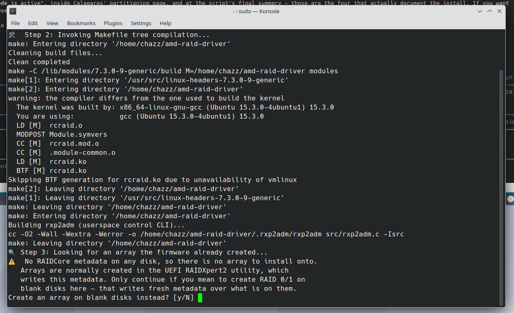
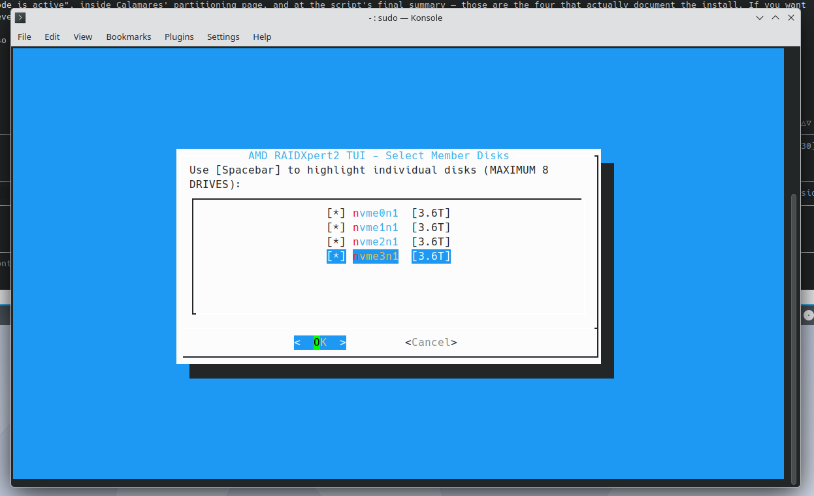
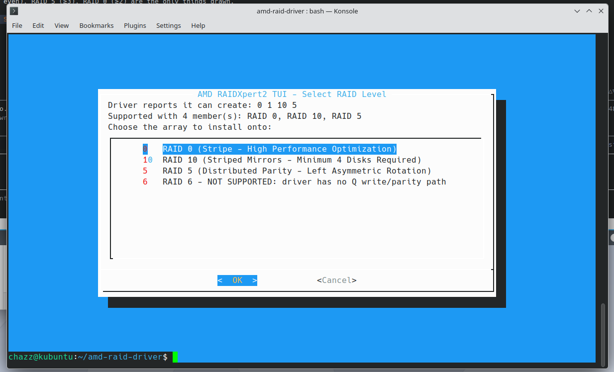
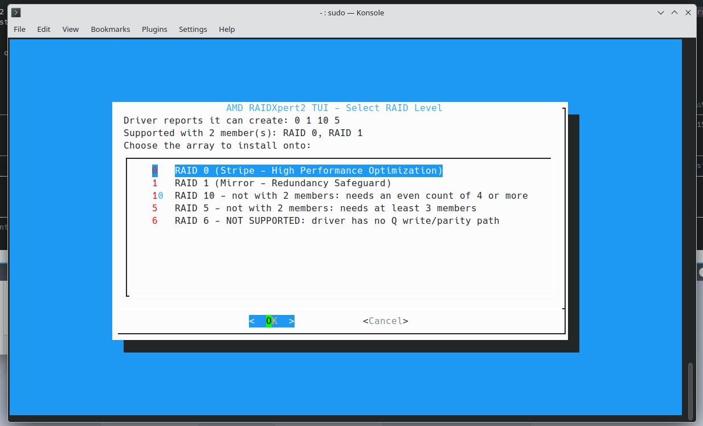
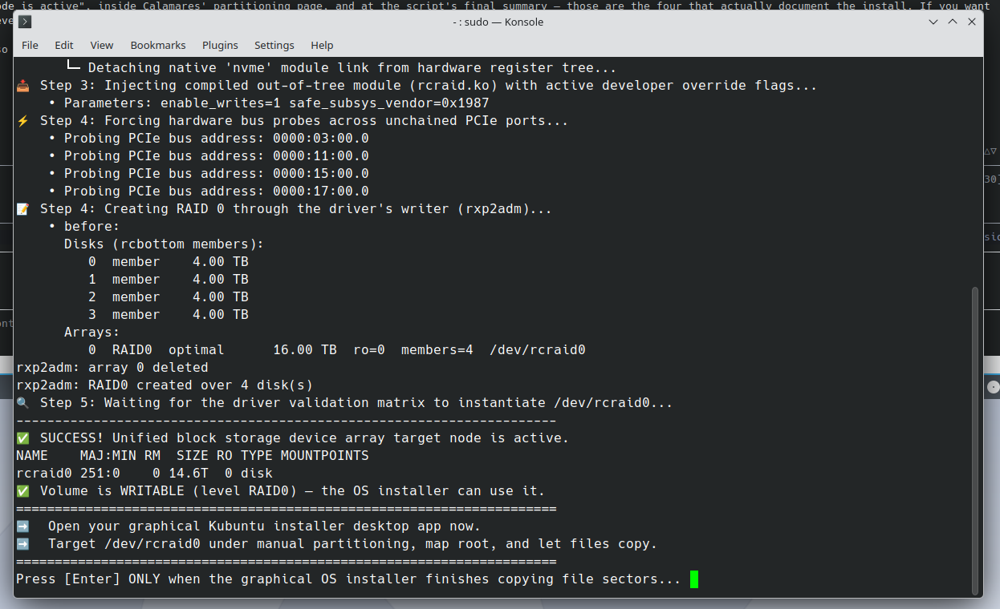

# Implementation Status

Current focus: **PCI 1022:B000 only** (TRX50 NVMe RAID Bottom). The AHCI
variants (`7905 / 7916 / 7917 / 43BD`) are not on the target hardware and
are **not claimed** — there is no code path yet, so those controllers stay
bound to `ahci` (see #7).

## Current state (2026-07)

The driver is a working daily-driver for **NVMe RAID0 and RAID1**: it boots
Linux from the array as rootfs (validated on hardware for both levels),
reads and writes at drive-limited speeds, and survives kernel updates via
DKMS. What's live today:

- **NVMe RAID0 + RAID1**, geometry auto-detected from on-disk RAIDCore
  metadata (member count, order, stripe size, RAID level — nothing
  hardcoded). The parser follows the **config-commit block** to the active
  config generation (the ring is a journal; deleted arrays' records
  persist in older generations) and derives the RAID level from
  **FirstCount × SecondCount** (firmware writes DeviceType 0x1BF6 for both
  levels). See the 2026-07-10 log entry below and
  [`REVERSE_ENGINEERING.md`](REVERSE_ENGINEERING.md).
- **RAID1 mirror semantics**: round-robin read balancing (~2× single-drive
  read throughput), write/discard fan-out to every mirror with last-ACK
  completion (an fsync can't pass while a mirror holds stale data).
  Hardware-validated 2026-07-10: Kubuntu 24.04 installed onto and booting
  from a 2× T700 RAID1; KDiskMark SEQ1M Q8T1 20.5 GB/s read /
  11.1 GB/s write on the mirror as rootfs.
- **Reads and writes** (`enable_writes=1`; installers set it). Writes stage
  through scatterlist-native DMA on the fast path — no bounce buffers. The
  fan-out paths merge physically-contiguous bio fragments before building
  PRPs (sub-page buffer-head writeback — mkfs metadata — is unexpressible as
  PRPs otherwise; see the 2026-07-10 log entry). Layouts that still cannot
  be expressed (XFS log recovery, requests with a page gap) fall back to a
  small mempool of bounce buffers; see the 2026-11-13 entry.
- **4 I/O queues × depth 256** per controller (blk-mq `nr_hw_queues=4`,
  1024 outstanding), MSI-X, fully interrupt-driven async completion. Each
  hctx has its own PRP-list pool (per-tag-per-member-per-hctx).
- **FLUSH, FUA, DISCARD/TRIM** wired up; volatile write cache enabled on each
  member at init.
- **Error handling**: 30 s timeout, per-adapter dead-flag, best-effort NVMe
  Abort, tagset drain, and automatic controller reset (manual sysfs reset as
  fallback). See "Error handling and reset (design)" below.
- **Boot-from-RAID** via dracut / initramfs-tools hooks; DKMS + udev autobind;
  live-CD install workflow; suspend/resume (S3/S4). Operational guards:
  `scripts/verify-boot-safety.sh` (checks every installed kernel's initramfs
  contains rcraid, on both initramfs-tools and dracut systems) and an apt
  kernel-hold drop-in installed by both installers so unattended-upgrades
  never pulls a kernel behind the DKMS rebuild's back.

RAID1 **degraded mode, degraded boot (opt-in `allow_degraded=1`), and
resync** now work: a member failure or hot-unplug keeps the volume
serving from the survivor; a re-added member is rebuilt from the
survivor online (write fan-out to the resync target + moving exclusion
window keep concurrent writes coherent); volume state is exposed in
`/sys/block/rcraid0/rcraid/` and debugfs.  Verified by the QEMU rig's
`--fail-member` round-trip (fail → degraded writes → re-add → resync →
kill the original survivor → checksums intact) and `--omit-member`
degraded-boot scenarios.
Not yet: **persistent degraded state** (in-memory only — a reload
re-assembles as if in sync; needs config-ring writer RE), **RAID10 hardware
validation** (the level is feature-complete; a driver-written 4-disk array was
created, assembled and read on 2026-11-13, but the firmware-array run in
[`VALIDATION_RAID10.md`](VALIDATION_RAID10.md) is still missing), RAID5/6
**write** dispatch (parity volumes still come up read-only by default; RAID 5
writes are opt-in with `enable_writes=1 parity_writes=1` — full-row P generation
and partial-row read-modify-write, QEMU-verified for full-row, in-row,
chunk-boundary and cross-row writes and hardware-validated on 2026-11-13 on a
4-member driver-stamped array, with the parity chunk XOR-checked on media; no
parity rebuild and no write-hole journal. A firmware-created 3-disk RAID 5 was parsed,
assembled and read on 2026-11-08 — `0x1BF5`, volume `optimal`, reads served,
forced read-only — but that array no longer exists, so it cannot be re-read;
the QEMU rig re-verified parity assembly on 2026-11-13 with a 4-member
synthetic fixture, but that fixture comes from our own encoder, not
vendor-written media),
hot-plug/rebuild, SMART pass-through,
multi-volume, array creation from Linux
beyond RAID0/RAID1/RAID10 (`rcadm -C` now stamps all three levels; the live
installer stamps nothing — it assembles the array the UEFI RAIDXpert2 utility
created; 10/5/6 firmware-compatible records, and the firmware-compatible
records RAIDXpert2/Windows would accept, are still open).
The prioritized roadmap is in [`IMPLEMENTATION.MD`](IMPLEMENTATION.MD); the
RE ground truth is in [`REVERSE_ENGINEERING.md`](REVERSE_ENGINEERING.md).

The sections below are the dated implementation log — how each piece was built,
kept for forensics. Where an early "Not started" / "Next steps" note has since
been implemented, it's marked.

## 2026-11-14 — The live installer stops creating arrays; the TUI is removed

`install-livecd.sh` used to fall back to an interactive array builder whenever no
disk carried RAIDCore metadata. It is gone (`4a44b30`): an install now requires
an array the **UEFI RAIDXpert2 utility** created, and stops with an error when
none exists. The flow it replaced, from the run that used it:


*After the build: no RAIDCore metadata on any disk, so "create an array on blank
disks instead?".*


*Every raw NVMe disk is offered, eight at most, with nothing to distinguish a
blank one from the disk the live session might be reading.*


*The level list came from what the module reported it could create, filtered by
the ticked member count; RAID 6 is listed and refused.*




*`mkmeta.py` bootstrapped RAID 0 records so the members would parse, then
`rxp2adm delete` + `create` stamped the chosen level and the script reloaded the
module to assemble it.*

Why it went:

- **It wrote metadata the firmware did not.** The records came from this tree's
  lab writers — `mkmeta.py` (RAID 0/1) and `rxp2adm` (0/1/10, 5 behind
  `parity_create=1`), metadata only, no data or parity initialisation. That is
  not a RAIDXpert2 array, and whether the UEFI utility or the Windows driver
  accept one is unvalidated rather than assumed.
- **It offered every disk.** The checklist had no guard beyond a count limit; on
  this box `nvme3n1` is the disk the firmware-RAID-5 check had to exclude as the
  root filesystem.
- **Saying yes erased.** The create path zeroed the metadata window, wrote fresh
  records over every selected disk, then deleted the volume and re-created it
  mid-session.
- **It was a second create path to keep in step**, carrying load-time knobs
  (`parity_create` to let the writer emit a parity record it had just chosen)
  that nothing else needed. The writers stay in-tree for the QEMU rig, where no
  firmware can produce those records.

## 2026-11-14 — CI gates actually run; the parity rig gains the contention case

Two things that were written down but never executed now execute.

- **CI ran for the first time in this repository.** The fork's workflow gate
  had suppressed every run since the workflow files landed, so `build`,
  `warnings`, `qemu-rig`, `spdx`, `whitespace` and `shellcheck` were
  descriptions rather than gates (the `spdx` job had in fact never matched a
  file — see `1828272`). With the gate lifted and the SPDX glob repaired,
  runs [43534608616](https://github.com/kubuntugamer/amd-raid-driver/actions/runs/43534608616)
  and [43535356259](https://github.com/kubuntugamer/amd-raid-driver/actions/runs/43535356259)
  are green: four kernel builds, all six QEMU scenarios, and every script
  gate. `docs/README.md` and `scripts/qemu-test/README.md` said "three kernel
  lines" and "intended foundation for CI"; both now state what runs.
- **The RAID 5 rig reproduces the write-stall shape.** `rcparitytest` step 5
  forks two writers that use buffered `pwrite` + `fsync` over disjoint rows —
  page-cache writeback reaching RMW concurrently, which is what wedged the
  3-member array (see the 2026-11-13 entry below). The earlier four steps are
  single-threaded `O_DIRECT` and cannot contend, so the fix's promise was
  untested in CI. A stalled queue now fails the step on a 180 s alarm instead
  of hanging the rig; `raid5-parity-write` passes with it on 4 members.

- **`/dev/rc_api` has automated coverage.** `scripts/qemu-test/api-read-test.c`
  replays the SG_IO sequence `rcadm` issues and asserts the packets field by
  field — `INQUIRY` page `0xD7`, the 1 KiB descriptor and window walk, the
  64 KiB config packet with every PhysicalDevice/ControllerDevice record, the
  `GET_CREATE_INFO` pair, and CHECK CONDITION + ASC for refused mutation
  frames. No AMD binary is involved, so the coverage is reproducible from the
  tree; the two degraded scenarios skip it by design. Issue #13.

- **The requeue fix ran on hardware.** The 3-member 256 MiB array was still
  stamped on `0000:03`/`11`/`15` (read back read-only first: `devtype=0x1bf5`,
  `cap=524288`, `devices=3`; `0000:17` carried only its raw-disk record). The
  module built from this tree was bound to those three members only and took
  five rounds of four concurrent buffered 16 MiB `conv=fsync` writers plus a
  4 KiB-block writer: every writer returned 0, all four regions matched after a
  cache drop, and dmesg carried no hung-task, parity or error line. `rmmod` was
  clean and the members went back to `nvme`. This is confirmation, not the
  gate — the fix stands on the status contract and on CI.

What this does not change: the container builds are compile-only, and nothing
here is a boot-from-RAID 5 run.

## 2026-11-13 — XFS log recovery: bounce fallback for non-PRP layouts (#20)

XFS could not be mounted read-write on the 4-member RAID0 array: recovery
writes a 256 KiB log record that spans chunks, and one member's SG run began
at in-page offset 3072, which a PRP list cannot encode. The driver already
merges contiguous bvec fragments (#45), but this layout has a page gap
between runs, so merging alone cannot fix it.

Added a bounded bounce fallback: a mempool of 8 × 1 MiB buffers allocated at
volume create. When an SG list has a non-first entry starting mid-page, the
request is copied through page-aligned per-member slices (RAID0 multi-stripe)
or one whole-request buffer (single-member and RAID1 writes); READs are
copied back only after a real completion, never on a pre-submit error. The
fast path is unchanged and still zero-copy.

Verified on hardware: `mount` read-write after `mkfs.xfs`, 1 GiB
write/readback hash, 400-file metadata workload, unmount/remount, clean
`xfs_repair -n`, and a two-iovec `O_DIRECT` round-trip whose second vector
starts at page offset 3072.

## 2026-11-13 — 3-member RAID 5 write stalled in writeback; requeue-contract fix

On the array box, after the 4-member fixture was deleted, a 3-member 256 MiB
RAID 5 was stamped by this tree's writer (`0x1BF5`, `devices=3`, chunk index
3 = 256 KiB, capacity `524288` sectors, elements at `0x105000`) and came up
read-write under `enable_writes=1 parity_writes=1` with 4 hw queues × depth
239. A buffered `dd … conv=fsync` to `/dev/rcraid0` then wedged: hung-task
reports ran from 122 s to 614 s with the task in
`blkdev_fsync → filemap_fdatawait_range → folio_wait_writeback`, and the
kernel log carried **no** rcraid message after the volume came up — no
timeout, no `-EBUSY`, no parity error. The reboot that ended the session was
needed to clear it (shutdown timed out flushing filesystems and SIGKILLed the
stuck process); it was a symptom cure, not a fix.

**Root cause.** `rc_volume_dispatch_parity_write()` answered a busy parity
lock (`down_trylock()` failure) with `BLK_STS_DEV_RESOURCE`, as it did for an
empty parity-buffer pool and for SQ-reservation exhaustion. Per
`include/linux/blk_types.h`, that status is a promise from the driver that
**it** will rerun the queue once the resource frees — and there is no
`blk_mq_run_hw_queue()` / `blk_mq_run_hw_queues()` call anywhere in `src/`.
The requeued request therefore sat on `hctx->dispatch` with nothing to
restart it, and the folio above it never left writeback. A single buffered
writer submits bios on more than one hw queue, so the second bio hits the
busy lock; a steady stream of new submissions normally re-runs the queue and
masks the missing kick, which is why the earlier 4-member runs — effectively
serialized — passed.

**Fix** (`src/rc_nvme.c`). The write path now waits instead of requeueing:

- The full-row dispatch takes `down(&rc_volume_parity_lock)` rather than
  `down_trylock()`. That is legal because the tagset carries
  `BLK_MQ_F_BLOCKING` for every parity level, and the matching `up()` still
  happens in `rc_volume_unmap_request_sg()` from the completion path.
- An empty parity-buffer pool while the lock is held is a leak, not
  contention (only this path takes a buffer), so it fails with a logged
  `BLK_STS_IOERR` instead of being handed back.
- SQ reservation retries for about 75 ms and only then returns
  `BLK_STS_RESOURCE`, which the block layer retries itself; `queue_rq` now
  passes both `BLK_STS_RESOURCE` and `BLK_STS_DEV_RESOURCE` back rather than
  ending the request with them.
- The three comments that documented the old "hand it back and requeue"
  behaviour were corrected, and the session's temporary `parity_debug`
  counters/sysfs attribute were removed with the fix.

**Verified so far.** Warning-clean `make` against `7.3.0-10-generic`, and the
QEMU rig (`--level raid5 --members 4 --parity-writes`) passes with full-row,
in-row, chunk-boundary and cross-row writes verified. The rig's parity test is
a single O_DIRECT writer, so it is a regression check, **not** a reproduction
of the stall.

**Still open.** One hardware pass with the fixed module: a concurrent
buffered write plus `fsync`. **Member count is not the variable** — the wedge
happened to land on the 3-member array, but the defect is a status-contract
violation that does not depend on N, and the pre-fix 4-member runs passing
says only that they did not hit the race. Any parity array will do; a 4-member
one is the convenient choice and gives more contention, not less. Nothing in
this tree has run on hardware since the fix.

The rig's parity test now forks two buffered writers (see the 2026-11-14
entry), so the contention shape is covered in CI even though it is not a
reproduction of the hardware timing. The hardware pass itself ran on
2026-11-14 (entry above): 25 concurrent-writer rounds, all clean.

## 2026-11-13 — RAID 5 writes validated on hardware (4 members)

The opt-in RAID 5 write path ran on the array box: 4× Sabrent Rocket Q 4 TB
behind `1022:B000`, kernel `7.3.0-10-generic`, root on USB, Secure Boot off.
The committed generation was a 4-member RAID 5 in this tree's writer layout
(`0x1BF5`, `FirstCount` 1, `SecondCount` 4, chunk index 3 = 256 KiB, capacity
`23,438,757,888` sectors, elements at `0x105000`); it assembled `optimal` with
`enable_writes=1 parity_writes=1 parity_create=1`.

Two full 768 KiB rows and four partial writes (4 KiB in-chunk, 8 KiB over a
chunk boundary, 8 KiB over a row boundary, 4 KiB in the last chunk) read back
byte-identical after a cache drop (`sha256 cf7e8780…c476e4`). Unloading the
driver and reading the members raw on `nvme` showed members 0–2 holding the
expected logical bytes and member 3 holding their XOR for both rows
(`c454ba92…`, `0fd6774f…`). A full `rmmod`/reload re-assembled the array at
the same capacity and readback matched; without `parity_writes=1` the volume
came up `ro=1` and refused a write. The 4 MiB metadata window on all four
members was unchanged.

Not covered: power-cut/write-hole behaviour, firmware acceptance of a
driver-stamped parity generation, a vendor-written array, and any member count
or chunk size other than this one.

## 2026-11-13 — RAID 5 degraded reads + parity rebuild (hardware)

On the same 4× Sabrent Rocket Q 4 TB box, on a freshly created 256 MiB RAID 5
fixture (`rxp2adm create -l 5 -d 0 1 2 3 -s 256`), 64 MiB was written with
O_DIRECT and read back byte-identical. Member 1 was failed through
`/sys/block/rcraid0/rcraid/fail_member`; the volume reported `degraded`, the
same 64 MiB read back byte-identical with the missing member's chunks
reconstructed from P plus the two surviving data members, and a write was
refused with `EIO`. `AMD_IOCTL_START_RESYNC` rebuilt member 1 over 174,762
sectors (85 MiB, the whole per-member user area), the rebuild completed and
the state returned to `optimal`; the 64 MiB readback and an 8 MiB write at
offset 64 MiB then passed. A separate fresh-create 9 MiB run passed the same
sequence.

Two code fixes came out of the run: parity volumes now allocate the per-member
coherent RMW buffers even when writes are disabled (degraded reads and rebuild
need them), and the synchronous PRP path now expresses a transfer whose last
page is partial, so the rebuild's 170-sector tail completes instead of
aborting. Without the opt-in the volume remains read-only; while degraded it is
also read-only, and the rebuild is manual. Still open: the write hole, parity
initialisation, automatic rebuild, vendor-written corroboration, and member
counts/chunk sizes other than 4×256 KiB.

## 2026-11-13 — Delete/create + I/O across RAID 0, 1, 10 and 5 (hardware)

Ran the full create/delete matrix on the array box (4× Sabrent Rocket Q 4 TB,
`1022:B000`, kernel `7.3.0-10-generic`), using `rxp2adm` for every delete and
create. Each level was created from scratch on the same four members, came up
`optimal`, and took a 768 KiB O_DIRECT write followed by a cache-dropped
readback:

| Level | Members | Capacity | ro | Result |
|---|---|---|---|---|
| RAID 0 | 0 1 2 3 | 16.00 TB (31,251,871,744 sectors) | 0 | PASS |
| RAID 1 | 0 1 | 4.00 TB (7,812,967,936 sectors) | 0 | PASS |
| RAID 10 | 0 1 2 3 | 8.00 TB (15,625,935,872 sectors) | 0 | PASS |
| RAID 5 | 0 1 2 3 | 12.00 TB (23,438,903,808 sectors) | 0 | PASS |

Every capacity is the expected multiple of the same per-member user size: 4×,
1×, 2× and 3× respectively.

The first run exposed a real RAID 1 bug: a read crossing a stripe boundary was
sent into the RAID 0 per-member stripe fan-out, which rejects mirrored members
(`rc_volume_dispatch_multi_stripe: member mismatch`), so RAID 1 reads larger
than one 256 KiB stripe (768 KiB and 1 MiB in the probe) failed with
`BLK_STS_IOERR`. RAID 1 reads now skip that branch
and use the single-member path, where `rc_volume_map_lba()` already selects a
live mirror — both mirrors hold the whole logical range, so one member can
serve the request. `make` is warning-clean, and the table above is the post-fix
run with zero driver errors. Screenshot:
[`image/raid-level-matrix-2026-11-13.png`](../image/raid-level-matrix-2026-11-13.png).

RAID 5 CREATE remains metadata-only over erased members: this run wrote only
the tested 768 KiB, so the rest of that volume is not initialised.

## 2026-11-13 — RAID 5 CREATE/DELETE through the driver and rxp2adm

The metadata writer no longer stops at 0/1/10. `rc_volume_create_array()`
accepts the parity DeviceType (`0x1BF5`) and emits the firmware geometry:
`FirstCount` 1, `SecondCount` = members, capacity `(N-1) x` the per-member user
area, elements at the full user size. `rxp2adm create -l 5` reaches it through
`/dev/amd_ctl0`; the rig deletes the synthetic RAID 5, re-creates it, and gets
the same capacity and `level=RAID5` back (`--create-test`). The CLI ships as
`rxp2adm` (`make rxp2adm`) so it is never mistaken for AMD's `rcadm` binary;
the implementation is the same clean-room tool.

`rc_volume_delete_array()` now recognises `0x1BF5`/`0x1BFA` LDs as well as
`0x1BF6`, so deleting a parity array no longer returns `ENOENT`.

Two limits are deliberate and documented:

- **CREATE is opt-in** (`parity_create=1`) and writes **metadata only**. It does
  not zero or rebuild the members' user-data regions, so it must only be used
  with erased disks; zero the volume before trusting it. Default remains a
  refusal with the reason in dmesg.
- **AMD's `rcadm` still cannot create parity arrays**: its licence check stops
  before any frame. The clean-room CLI is the path this tree tests. RAID 6
  CREATE is still refused (no Q write/initialisation path).

## 2026-11-13 — On-metal CREATE/DELETE, and the read path at hardware speed

- **CREATE and DELETE ran against this driver on four 4 TB members**
  (issue #15). DELETE removed the array LD from every member's active
  generation and re-committed it; a forced re-probe then found only the
  raw-disk LD and refused to register. CREATE stamped exactly the named
  members and assembled a 16 GiB RAID 0 that `rcadm` listed as `NORMAL`.
  One caveat is unresolved: `-ca rw` printed the caching-licence warning and
  still sent its frame, so a gated option neither fails nor is accepted.
- **A vendor-driver DELETE is not proof the metadata is gone.** Before the
  run, every member still carried a committed 4-member RAID 0 LD after
  `rcadm -D` under the vendor module. Dump LBA `0x5000` and read the active
  generation before believing a CLI exit code.
- **The blacklist trap that made the rig bind nothing:** `blacklist nvme` in
  `/etc/modprobe.d` does not stop the initramfs from loading `nvme` first, so
  `rc_init` logged `Found 0 adapters`. It needs `install nvme /bin/false` plus
  `update-initramfs -u`, and `modprobe -r nvme` at runtime before binding.
  The `rd.driver.blacklist=nvme` note in `README.md` now carries the same
  warning.
- **Measured read path (issue #14):** 4× Sabrent Rocket Q, firmware RAID 0,
  read-only — 13,276 MiB/s sequential (100.0 % of the four members' raw
  aggregate, 3.8× a single member at QD1) and 1,846,226 IOPS at 4 KiB random
  with 128 outstanding (93.7 % of raw). Method and full table in
  [`README.md`](README.md#benchmarks).

## 2026-11-13 — rcadm CREATE across every level; the exit-1 cause; vendor bootstrap wedged

Issue #16 ran `rcadm -C` for every array type the 9.3.3-00302 CLI offers
against this driver on 4 × 4 TB NVMe (`enable_writes=0`, all four members
bound), deleting each array afterwards and reading 16 MiB from every one that
assembled. What it settled:

- **Sizing is right for every level.** The default and `-ms` come from the
  `GET_CREATE_INFO` reply (`0x100D`, `RC_WpGetCreateInfo`): 15,259,703 MiB
  for 4-disk RAID 0, 7,629,851 for 2-disk RAID 0, 3,814,925 per RAID 1/10
  copy. The old 17,180 MiB for everything was our `PacketSize` being read as
  the maximum.
- **The writer stamps exactly the named disks**, with capacity
  `user × data_members`: RAID 0 ×4 = 31,251,871,744 sectors, RAID 0 ×2 =
  15,625,934,848, RAID 1 = 7,812,966,400, RAID 10 ×4 = 15,625,934,848. All
  four assemble `optimal` and read back. The earlier subset failures were
  `-d` selection stored in `file->private_data` while `rcadm` opens
  `/dev/rc_api` twice; it now lives at module scope and is used only when the
  frame's `DeviceCount` matches (`45a7d4a`).
- **JBOD (`0x1BF7`) and RAIDAble (`0x1BFB`) are still refused** by the
  `0x1BF6 && SecondCount == 1` gate. A subset like `-C -r0 -d 0 1` used to
  fall back to stamping every bound disk; the module-scope disk list fixes
  that. RAID 5/6 are different: the CLI stops at "not licensed", so no frame
  is sent at all and the driver's own refusal is untested through this verb.
- **CREATE still exits 1 on success.** The Id is not the cause: `PreferDeviceID`
  is stamped verbatim (`d5d4389`) and `-M -qa` lists it. After the config
  write, `RC_ApiCreateLogicalDevice` calls `RC_FindLogicalHandle(core, id)` on
  an in-process config that predates the mutation, and the driver's `0x1000`
  re-read does not refresh it — hence `LOGICAL_DEVICE_NOT_FOUND` (10). A
  fresh `rcadm` lists the array, and DELETE (no post-write lookup) exits 0.
  Closing this needs the vendor kernel's mutation-reply semantics.

The vendor-driver bootstrap from the same issue — build fixes for 7.3, blob
patch offsets, the post-reboot sequence — is written up in
[`VALIDATION_RAID5.md`](VALIDATION_RAID5.md) §3c, because it is the only way
to obtain vendor-written RAID 5 bytes. It is blocked on a reboot: the first
load with the unpatched blob oopsed inside `load_module` and left
`module_mutex` held, so neither module can load until then. Vendor artefacts
stay outside the tree, unlinked.

## 2026-11-13 — RAIDCore checksums corroborated on vendor-written members

The checksum algorithm was the top blocker on every `rcadm` mutation verb:
`RC_GenerateChecksum` had been documented from the vendor blob but never
round-tripped against a `Checksum` read off a member the firmware wrote, so a
writer could satisfy this driver and `mkmeta.py` while BIOS rejected the
generation.

- Both checksummed blocks store `Checksum` at `+0x00` over `[0x08, 0x200)`:
  `RC_MetaData` at LBA `0x5000` and `RC_ConfigCommit` at `0x5001`. The
  algorithm in `rc_meta_build.h` / `rc_raidcore_checksum()` reproduces the
  stored value on **all four** members of the X399 fixture set
  (`PlaidPiper/x399-raidcore-fixtures`, `sha256sum -c` clean).
- The check is in the tree rather than a throwaway harness:
  `scripts/qemu-test/verify-checksums.py <dump>...` prints per-block
  stored/computed values and exits non-zero on any mismatch; a dump with one
  byte changed is rejected.
- Both encoders were writing a generation timestamp where the vendor keeps
  this commit checksum (`src/rc_meta_build.h`, `mkmeta.py`). They now compute
  it over `[0x08, 0x200)`. The parser never read that word, so assembly is
  unchanged, but metadata stamped from this tree now matches the firmware's
  layout; `make test-metabuild` still diffs the two encoders byte for byte.
- **The two remaining writer unknowns were settled from the live array,
  read-only (2026-11-13).** The four members of this box's firmware-created
  RAID 0 verify both checksums, and the committed generation was walked in
  full: `+0x00` is the generation timestamp (no checksum), then
  `6 × 0x25BC` 128-byte records (the controller record, the members, and a
  non-member disk), then the `0x25BD` records, then `6 × 0x25BE` controllers.
  So the packet checksum is a runtime-view field a persisted generation never
  carries, and the member stamp is the `0x25BC` record already inside the
  generation. Reproduce with `scripts/qemu-test/inspect-generation.py`.
- **The gap that replaces them: our encoders omit two sections of that
  layout.** `rc_mb_generation()` / `mkmeta.py` write only the raw and array LD
  records. The parser needs nothing else and the rig assembles, but firmware's
  generation is PD-then-LD-then-CTRL; a writer aimed at BIOS acceptance has to
  emit that order. RAID 5/6 create stays blocked on the parity write path, and
  TRANSFORM/SPLIT/COPY remain OCE/ORLM work.
- **A stamped RAID10 set reached the RAID10 data path, found a read defect,
  and now passes the full battery.** `rcstamp --level raid10` on four members
  assembles as RAID10 at the expected capacity (`FirstCount` 2 × `SecondCount`
  2), and both copies of each pair hold identical data at the expected physical
  stripes. Its first run failed readback because
  `rc_volume_dispatch_raid10` re-rolled the read copy per bvec chunk: one
  logical stripe was split across BOTH copies of its pair, and each member
  command then read a contiguous physical run into a non-contiguous
  scatterlist, so pages after the first came back duplicated
  (`D0, D1, D1, D2, D2, …`). Choosing one copy per logical stripe fixes it; the
  write/readback, reload, discard and mke2fs battery now passes on the stamped
  RAID10 set. The QEMU matrix has never included RAID10, which is why the path
  had no coverage. Still no array-box run.

## 2026-11-10 — Signing after the fact, from the installed system

- **`install-dkms.sh` now accepts `RCRAID_MOK_ENROLL=1`**, which is the answer
  for a machine that was installed with Secure Boot off: `mok_setup_signing`
  uses it where enforcement used to be the only reason to act — create a key
  when none exists, point DKMS at it, sign, and queue the enrolment — while an
  enforcing kernel still has to succeed. Without the variable nothing changes:
  with Secure Boot off and no key on disk the installer stays a no-op instead
  of growing a key and a MOK prompt nobody asked for.
- **README's install section gained Phase 3**, the post-boot half of signing:
  answer the MOK prompt if the live installer queued one, or run
  `sudo RCRAID_MOK_ENROLL=1 ./install-dkms.sh` from a checkout inside the
  installed system, reboot and enrol, and only then switch Secure Boot on.
  `docs/INSTALL.md`'s knob table and "signing by hand" note follow the new
  semantics. The README is the place that says it, because it is the install
  path users read.
- **`scripts/raid5-live-test.sh` refuses an enforcing live session before it
  unbinds the members**, mirroring `install-livecd.sh`: a key enrolled in a
  live session is only trusted at the next boot, so signing there produces a
  module the live kernel still rejects.

## 2026-11-08 — Installer side: module signing moved to the post-install reboot

- **Both installers now split key signing across the reboot instead of
  demanding an enrolment reboot before the install.** `install-dkms.sh` used
  to abort under Secure Boot when no enrolled key existed, telling the user to
  create one, `mokutil --import` it and reboot — then install, then reboot
  again. It now creates the key pair (or reuses the shim key
  `update-secureboot-policy` leaves in `/var/lib/shim-signed/mok/`), points
  DKMS at it through `/etc/dkms/framework.conf.d/rcraid-signing.conf`, builds
  and signs, and queues the enrolment with a generated one-time password. The
  reboot the install already needs finishes the job: shim's MOK manager runs
  before the kernel, so the module in the initramfs is trusted the first time
  it loads. The check that DKMS really signed (per installed kernel) stays, and
  now fails the install rather than the boot.
- **`install-livecd.sh` cannot sign its own session**, and now says so up front
  instead of dying at `insmod`: the live kernel rejects the unsigned module,
  and the only key that could sign it would need an enrolment reboot of the
  live session — discarding the session and the key. Secure Boot must be off
  for the live phase; the installer then asks whether to give the *installed*
  system a key, signs the DKMS build inside the target, queues the enrolment
  there, and prints the password for the target's first boot. Re-enable Secure
  Boot after that prompt is answered.
- Shared logic lives in `scripts/lib/secure-boot.sh` (enforcement probe, key
  discovery/creation, DKMS drop-in, `mokutil` enrolment with pending
  verification, user-facing instructions); `verify-boot-safety.sh` reports a
  still-queued enrolment, and `uninstall-dkms.sh` now removes rcraid's signing
  drop-in (leaving the enrolled key, which other modules may share).
- **The live installer no longer invents the array — and no longer offers to.**
  `install-livecd.sh` used to list every NVMe disk in a TUI and stamp fresh
  RAID 0/1 metadata over the ticked disks — wrong for a firmware array, which
  has nothing to tick and is usually a level `mkmeta.py` cannot produce (the
  3-disk RAID 5 would abort outright). It read the RAIDCore magic at LBA
  `0x5000` and, when found, took exactly those disks as members and wrote
  nothing; level and geometry came from the firmware's records. On 2026-11-14
  the leftover create path went too: the script now stops with an error when no
  disk carries that metadata, `scripts/phase1-tui.sh` is gone, and the only
  writers left in the tree (`scripts/qemu-test/mkmeta.py`, `rxp2adm`) are for
  the QEMU rig over blank images. Checked against the test box's firmware RAID
  5: detection returns exactly `nvme0n1 nvme1n1 nvme2n1` and excludes the root
  disk `nvme3n1`.
  The installer also **states whether the volume is writable**, and refuses to
  hand it to the distro installer when it is not: `/sys/block/rcraid0/ro` is
  the authority, the level is taken from the driver's `(level=…)` assembly log,
  and RAID 5/6 come back with the parity-write explanation (issue #6) rather
  than a silent read-only disk. The fake `mknod` “sandbox” device node that
  used to paper over a missing `/dev/rcraid0` is gone; that now fails with the
  dmesg/lspci commands to run.
- **Phase 2 of the live installer now leaves the same footprint as
  `install-dkms.sh`.** It was missing the apt kernel-hold
  (`52-rcraid-kernel-hold`), so on a machine booting from the array an
  unattended kernel update could rebuild the module with nobody watching, and
  it did not stamp `.rcraid_rev`, so a target-built module reported its source
  as `unknown`. Both are installed now, before `update-initramfs` runs.
  Checked the hook against a real initramfs-tools 0.151 build (Ubuntu 25.10+ /
  Kubuntu 26.10, the distro this installer targets): the regenerated image
  carries `usr/lib/modules/<kver>/updates/dkms/rcraid.ko.zst`, the udev rule
  (both `/etc/udev` and `/usr/lib/udev`), `modprobe.d/rcraid.conf`,
  `/usr/sbin/rcraid-bind` and its `dd`/`od` helpers. The hook needs no change
  for that release — `manual_add_modules` now queues and `apply_add_modules`
  copies, and mkinitramfs calls the latter after the hooks. Note for anyone
  auditing this by hand: `/boot/initrd.img-*` is mode 0600, so `lsinitramfs`
  must run as root — `verify-boot-safety.sh` already does.
- **Installers repaired for the restructured tree.** Both scripts still
  described the pre-`e4695ce` layout: a root `VERSION` file (deleted), `rc_*.c`
  at the repo root (they live under `src/`) and an `@PKGVER@` placeholder that
  `dkms.conf` no longer carries. `install-dkms.sh` died on its second command,
  so none of the signing work above could be reached. The package version now
  comes from `dkms.conf`'s `PACKAGE_VERSION` — the same value passed to
  `dkms add/build/install`, so the staged tree and the dkms tree cannot
  disagree — `docs/VERSION` is staged as `VERSION` for the banner/`modinfo`
  stamp, and staging mirrors the repo layout (build files at the root, sources
  under `src/`, userspace `test_*.c` excluded). Verified by running the
  installer on the box — staged build in kbuild's `M=` form, DKMS signing with
  the already-enrolled shim key, per-kernel signature verification, initramfs
  regeneration — then uninstalling and confirming every artefact was gone.

## 2026-11-08 — First firmware RAID 5 metadata; RAID1 classification fix; installer stamps real metadata

- **Real 3-disk RAID 5 record parsed; `0x1BF5` is RAID 5, not RAID 6.** A
  RAIDXpert2 BIOS-created 3× Sabrent Rocket Q array reports
  `DeviceType=0x1BF5, Devices=3, FirstCount=1, SecondCount=3,
  Capacity=15,625,838,592`, `UserDataSize=7,812,919,296` per member
  (`= Capacity/2`, i.e. `(N-1)`), `UserDataOffset=0x105000`, and
  `ChunkIndex=3` (256 KiB). The driver rejected it outright because it mapped
  `0x1BF5` to RAID 6 and requires ≥ 4 members. The vendor dispatch settles the
  encoding — parity count = `(DeviceType == 0x1BFA) + 1` — so the two
  constants were swapped; `rc_linux.h` now has RAID5=`0x1BF5`,
  RAID6=`0x1BFA`. Level *placement* is settled from the vendor blob:
  dedicated parity on member `N-1`, no rotation, and `patch_parity_math.c`
  now implements that layout (it used to rotate; issue #6,
  `docs/REVERSE_ENGINEERING.md`). The layout therefore rests on the vendor
  implementation rather than on inference from one array; what has not
  happened is reading a vendor-written array back through the driver.
  `docs/VALIDATION_RAID5.md` records the observed geometry and that
  corroboration step.
- **A non-member disk with valid RAIDCore metadata no longer takes the
  legacy fallback.** The array box has a fourth `1022:B000` drive whose
  metadata is valid but whose DeviceId appears in no LD record (a spare, or a
  stale member). Since `md_valid` was set but never read, such a disk fell
  through to the BDF-ordered fallback as a RAID0/2-member seed and could
  out-race the real members at probe time. The parser now sets
  `ld_record_seen` when a committed generation names an LD, and
  `rc_volume_register_member()` refuses the fallback when that LD does not
  name the disk. The fallback remains for metadata old enough to have no LD
  record at all.
- **Read-only RAID 5 validation tooling.** `scripts/validate-raid5.sh` checks
  the trust gate, `level=raid5`/member count/`(N-1)` capacity, read-only
  enforcement (including a write that must fail), cache-dropped O_DIRECT
  reads at five offsets with repeatability, and a dmesg tripwire. It never
  writes to the array. `scripts/raid5-live-test.sh` wraps it for the live
  box: signs/loads the module, binds the members (restoring them on an
  `insmod` failure), and verifies a staged 64 MiB ext4 fixture whose rows
  carry `P = D0 XOR D1`. The fixture was written directly to the members,
  reconstructed byte-for-byte, and `e2fsck`-checked. **Superseded later the
  same day:** when this was written the script had not run against a loaded
  driver, because Secure Boot rejected the unsigned test module (`Key was
  rejected by service`) and the MOK key still needed enrollment. That key is
  now enrolled, the module loads, and both scripts have run against the loaded
  driver — see the live-array and map entries below.
- **`rc_ld_level_from()` never mapped firmware's RAID1 encoding.** Real
  firmware writes `DeviceType 0x1BF6` with `FirstCount=1 SecondCount=2` for a
  2-way mirror (see `rc_linux.h`), but the `0x1BF6` arm only mapped
  `SecondCount == 1` to RAID0 and `FirstCount >= 2 && SecondCount == 2` to
  RAID10. A mirror record therefore fell through to the safety reject, and each
  member was dropped with "unsupported RAID layout … ignoring member", so the
  volume could not assemble at all. The mirror branch existed only under the
  phantom `0x1BF7` encoding (added in `eaf5c34`), which real firmware does not
  write. Caught by the QEMU rig's RAID1 runs, which failed at **assembly**
  rather than in failure handling; with the branch restored, RAID0 and RAID1
  both pass on the rig, including `--fail-member` and `--omit-member`.
- **`install-livecd.sh` now writes metadata instead of a 4-byte tag.** It
  stamped `0x25BD` + level at LBA `0x5000` and then printed `[Matches: OK]`
  without comparing anything, which no parser can validate
  (`rc_nvme_read_validate_metadata()` needs `RAIDCore` magic at `+0x08`, the
  version, the XOR-lane checksum, a config-commit block and an LD record in the
  ring). It now calls `scripts/qemu-test/mkmeta.py` — the only writer in the
  tree that produces valid blocks — and reads the magic back off every member
  before reporting success. RAID10/5/6 selections fail with a message pointing
  at firmware RAIDXpert2 rather than stamping an unvalidatable layout.
- **The `amd_ctl0` control node is registered and live.** `rc_init()` now
  calls `rc_amd_init_ioctl_bridge()`, which registers a `misc` device at
  `/dev/amd_ctl0` (mode 0644). `rc_amd_exit_ioctl_bridge()` removes it before
  the volume is torn down. The old `register_chrdev()` path was replaced
  because it allocated a major but never created a node.
  Read-only `AMD_IOCTL_GET_STATUS` and `AMD_IOCTL_GET_HARDWARE_INVENTORY` are
  available without privileges, so `rcraidXpert` can open the node `O_RDONLY`.
  `AMD_IOCTL_FAIL_MEMBER`, `AMD_IOCTL_START_RESYNC`,
  `AMD_IOCTL_COMMIT_NEW_ARRAY`, and `AMD_IOCTL_DESTROY_ARRAY` require
  `capable(CAP_SYS_ADMIN)` — `capable()` rather than `ns_capable()`, because
  these actions reshape state shared by the whole system — and log the caller
  on refusal. Array create/destroy remain `-EOPNOTSUPP`; the metadata-writing
  path is still unimplemented.
  The commands now target the assembled volume (`rc_volume_get_status()`,
  `rc_volume_fail_member_slot()`, `rc_volume_request_resync()`) instead of the
  idle async mirror engine. RAID 5/6 resync is refused because there is no
  live rebuild path. The kernel and `rcraidXpert` share
  `src/amd_raid_uapi.h` for the ioctl numbers and packed inventory payload.
- **The QEMU rig resolves a static busybox itself (issue #5).** It used
  `command -v busybox`, i.e. PATH order, which normally lands on the dynamic
  `/usr/bin/busybox` from `busybox-initramfs`; the "not static" check then
  aborted the run *even though `busybox-static` was installed*, and the only
  workaround was prepending a private directory to PATH. It now probes the
  `busybox-static` paths explicitly (`BUSYBOX=` overrides), names the binaries
  it rejected, and prints the one it chose. With the dynamic binary first in
  PATH: `==> busybox: /usr/bin/busybox-static`, then RAID0 PASS.
- **Hardware probe of this tree's NVMe path** (4× `1022:B000`, Sabrent Rocket Q
  `1987:5012`): `insmod` alone claims 0 adapters (the PCI core never steals
  devices bound to `nvme`); binding three spare slots by `driver_override`
  probes them clean — admin queue, 4× 256-deep I/O queues per drive, VWC on,
  `bad magic … orphan`. No volume, as expected without metadata.
  Box: MSI MAG X870E TOMAHAWK MAX WIFI (MS-7E59), Ryzen 7 9700X (8C/16T),
  32 GB, kernel `7.3.0-10-generic`, Secure Boot on. Four `1022:B000` at
  `03`/`11`/`15`/`16:00.0` (all Sabrent Rocket Q 3.7 TB, fw `RKT30Q.3`),
  plus two `1022:43bd` SATA-RAID controllers at `06:00.0`/`0a:00.0` left on
  `ahci` — the same class-`0104` "invisible members until ahci claims it"
  behaviour PlaidPiper reported on X399. No member carries `RAIDCore`
  metadata (LBA `0x5000` is zeros on the three spare disks), so a firmware
  array — and with it every NVMe bottom-path claim — still needs a BIOS
  RAIDXpert2 create.
- **X399 fixtures re-verified independently (2026-11-08).** The 2026-10-07
  pass went through a throwaway harness that was never committed, so the
  claim was re-checked from scratch against the published dumps
  (`sha256sum -c` clean) using a fresh userspace reimplementation of the
  `rc_linux.h`/`rc_nvme.c` rules: **15/15 checks pass** — magic/version/
  XOR-lane checksum on all four, commit block `0x5001` and ring `0x5800`,
  timestamp linkage `0x44e3270d8b7f9c46` equal to each generation header,
  `0x1BF6`/`devices=4`/2×2/`chunk_index=1`→64 KiB, capacity
  `39063609344 = 2 × UserDataSize`, `UserDataOffset` uniform at `1069056`,
  element DeviceIDs matching each member's own header ID, committed LD
  packet (784 B) byte-identical while generation LBA and commit sequence
  differ per member, and the `0x1BF9` raw-disk LDs present *only* in stale
  journal sectors. The harness is not in the tree; if this check is worth
  repeating, it belongs in `scripts/`.
- **RAID10 wider than 2×2 is admitted on an unverified assumption.**
  `rc_ld_level_from()` accepts any `FirstCount >= 2` with `SecondCount == 2`
  (`SecondCount > 2` is rejected), and the mapping then pairs `{0,1}`,
  `{2,3}`, … — so a 6-member 3×2 assembles on the adjacent-pair convention
  that only 2×2 hardware corroborates. Documented as a boundary in
  [`VALIDATION_RAID10.md`](VALIDATION_RAID10.md) step 1.
- **RAID 5/6 map switched to the vendor's dedicated parity (issue #6).**
  `rc_amd_map_distributed_raid5()` now returns `parity = N-1` and
  `target = stripe % (N-1)` with no row term; RAID 6 puts P/Q on `N-2`/`N-1`
  and data on `0..N-3`. Layout comes from the DWARF-bearing vendor core
  (`RC_RAID5DriveMap`: `(lba >> chunk_pow) % (Devices - 1)`), not from
  inference. `test_parity_userspace` was updated in the same commit — its
  bijection and packing checks asserted the old rotation and now encode the
  dedicated layout — and passes. Live check on the dev array: rebuilt module
  loads signed, assembles `optimal`, reads are stable, and the first 64 MiB
  hashes `7321098d…ed2a3` instead of the rotating-map `63bf7f7d…c83673`,
  which is the new map showing up in the data path. The fixture was then
  re-stamped under the dedicated layout — member 0/1 hold alternating chunks,
  member 2 the row XOR — and the first 64 MiB read back byte-identical to the
  logical image again (`63bf7f7d…c83673`: same bytes, new placement), with the
  ext4 filesystem mounting read-only and every file checksum matching. That
  makes the read path self-consistent with the map the code implements; it
  still cannot discriminate against a vendor-written array (issue #6).
- **RAID 6 Q is now the vendor's EVENODD construction (issue #10).** The
  generator is no longer GF(2⁸) Reed-Solomon: Q is XOR plus a modulus by 17
  over the vendor's 512-byte unit — sixteen 32-byte words, seventeen
  diagonals, the skipped diagonal carried in an `S` term. It lives in
  `src/raid6_evenodd.h`, which `src/test_parity_userspace.c` includes, so the
  harness compiles the code the module ships instead of the private copy it
  used to carry; that duplicate is what would have let the two drift. The
  GF(2⁸) exp/log tables are gone from `src/`. Checked in userspace: hardcoded
  vectors at 4 and 16 data members, the diagonal topology per word, and
  two-member recovery solved as a GF(2) system for every pair across 2..16
  data members (full rank throughout). The generator still has no kernel
  caller — RAID 6 is read-only — so this tree writes no Q yet, and agreement
  with firmware-written parity remains unobserved.

## 2026-10-07 — X399 fixtures verified; RAID10 pair convention settled

PlaidPiper's four raw X399 metadata dumps
([`PlaidPiper/x399-raidcore-fixtures`](https://github.com/PlaidPiper/x399-raidcore-fixtures),
via [issue #1](https://github.com/kubuntugamer/amd-raid-driver/issues/1) and
joeytroy#57) were run through a userspace port of this driver's exact
validation chain — **all four parse clean** (magic, XOR-lane checksum, commit
block at `0x5001`, generation-timestamp linkage, LD tag `0x25BD`), with the
committed LD record byte-identical across members and the per-member header
fields differing exactly as designed. The dead-generation pitfall (#44) shows
up in the real data: stale ring generations ahead of the committed one, plus
`0x1BF9` single-disk LDs that exist *only* outside the committed generation —
and the commit-block-following logic handles both.

The same reporter then cross-dumped all four members at a common
`UserDataOffset`: element 0 ≡ element 1, element 2 ≡ element 3 (byte-identical
within a pair, different between pairs), at both element 0/1 and element 2/3.
That settles the **last unverified RAID10 assumption** — the pair convention
is **adjacent** (`{2c, 2c+1}`), as `rc_nvme.c` assumes, not strided. Still
open for the runbook: confirming the same on this box's NVMe path, and 4-way /
8-way topologies (2×2 only was cross-dumped). See
[`REVERSE_ENGINEERING.md`](REVERSE_ENGINEERING.md) (X399 section) and
[`VALIDATION_RAID10.md`](VALIDATION_RAID10.md) step 1.

## 2026-07-10 — RAID1 hardware validation (PRs #43, #44, #45)

Reformatting the dev box for a real BIOS RAID1 array turned hardware
validation into a bug hunt that ended with the box booting from the mirror.
Every failure below shipped past the QEMU rig as it then existed; each fix
landed with the rig upgraded to regression-test that exact class.

- **Secure Boot preflight** (#43): the live installer died at insmod with
  "Key was rejected by service" — a BIOS reset had silently re-enabled
  Secure Boot. Both installers now read the SecureBoot efivar up front
  (failing closed on unreadable/truncated variables) and abort with
  instructions before building anything.
- **The config ring is a journal; the commit block names the truth** (#44):
  the driver assembled the box's *deleted* RAID0 (3.69 TB, writable!)
  instead of the new RAID1 — deleted arrays' LD records persist in older
  config generations, DeviceIDs are per-disk, so first-match-in-ring finds
  the corpse, and the stale record is internally consistent so the
  geometry-trust gate never fires. The commit block at ConfigCommitOffset
  names the active generation (extent + timestamp linkage, both now
  validated). Same PR: firmware writes DeviceType 0x1BF6 for RAID0 *and*
  RAID1 — the real level encoding is FirstCount × SecondCount (stripe
  width × mirror count).
- **Three latent concurrency bugs** (#44, exposed by the new CI rig):
  boot-time sync metadata reads raced the per-queue ISR on the same CQ
  during module reload (fixed with a locked handshake + dedicated
  *sequenced* sync CIDs — a fixed CID 0 aliases blk-mq tag 0, and a stale
  CQE from a timed-out sync command must not satisfy the next one); the
  ISR's direct-end fast path could double-complete a request against the
  dead-member drain (fixed with an atomic per-request completion claim);
  raw single-disk LDs (0x1BF9) could assemble as a bogus 1-member volume
  (their element array *is* the disk's own DeviceID — devices < 2 records
  are now skipped).
- **Fan-out scatterlists must merge contiguous fragments** (#45): the OS
  install died at mkfs — every mirror write of mke2fs metadata rejected by
  both members with NVMe SC 0x13 "PRP Offset Invalid". The hand-rolled
  bvec walks in the mirror/multi-stripe paths built one sg entry per bvec;
  sub-page buffer-head writeback then puts non-first segments at in-page
  offsets, which PRP lists cannot express. `blk_rq_map_sg` (the
  single-member path) merges — the fan-out builders now do too
  (`rc_volume_sg_append`), and `rc_volume_build_prp` rejects
  unexpressible layouts with one clean I/O error instead of submitting.
- **CI now boots the driver in QEMU on every PR** (`qemu-rig` jobs,
  raid0 + raid1): synthetic metadata booby-trapped with a stale decoy
  generation and a raw single-disk LD, plus a guest battery of
  write/readback, 3× module-reload cycles (with legacy-fallback
  detection), discard+rewrite, and a real bundled `mke2fs` run.

## Where we are

### Done — NVMe controller and admin path

- **PCI-ID-based code path selection** (`rc_firmware.c`). DEV_B000 →
  NVMe, AHCI variants → AHCI, anything else → stub.
- **NVMe controller boot** (`rc_nvme.c`, `rc_nvme_init_controller`).
  Reads `CAP`, disables, allocates 4 KiB-aligned admin SQ/CQ, programs
  `AQA/ASQ/ACQ/CC`, waits for `CSTS.RDY`. `MQES` is decoded as `u32` so
  the controller's `0xffff` max-queue value doesn't overflow.
- **AHCI register programming gated** on `ctrl_mode == AHCI`.
- **Doorbell helpers** for both admin and I/O queues, at
  `BAR0 + 0x1000 + (2 * qid | 2 * qid + 1) * (4 << DSTRD)`.
- **Admin command framework** (`rc_nvme_admin_cmd`). Builds an SQE,
  rings doorbell, polls CQ, advances head, returns SC/SCT.
- **Identify Controller** (CNS=`0x01`). Logs `VID/SSVID/SN/MN/FR/NN`.
  Confirms the AMD RAID Bottom is transparent at the NVMe admin layer
  on this hardware — the Crucial drives answer directly.
- **Identify Namespace** (CNS=`0x00`, NSID=1). Logs `NSZE/NCAP/NUSE`
  and the active LBA format; stashes the LBA size into adapter state.
- **I/O queue pair (qid=1)** via Create I/O CQ + Create I/O SQ admin
  commands. Polled completion, depth=64.
- **First NVMe READ** through the I/O queue — end-to-end SQE → doorbell
  → poll → CQE → status check → CQ-head advance → CQ doorbell.

### Done — RAID0 assembly

- **RAIDCore metadata** at LBA 0x5000 of each member.
  - Magic `RAIDCore` = `0x65726F4344494152` LE at offset 0x08.
  - Version `0x00030000` at offset 0x2C.
  - Stripe size at offset 0x28 (= 2048 sectors = 1 MiB on this array).
  - Per-member UUID at offset 0x10; per-member fields at 0x30/0x34/0x38.
  - Validating checksum at offset 0x00, computed by a ported version of
    `FUN_1400014ec` from `rcraid.sys`.
- **Stripe-mapping math** (`rc_volume_map_lba`):
  `member = (logical_lba / stripe) mod nmembers;
   phys   = ((logical_lba / stripe) / nmembers) * stripe + (logical_lba % stripe)`.
- **Volume registry** keyed off PCI BDF order, populated as each
  adapter's metadata validates. Fires `rc_volume_create_disk` at the
  expected member count (hardcoded `2` for now — see Open Questions).
- **/dev/rcraid0 gendisk** (blk-mq, qid=1, polled, read-only). Routes
  reads through `rc_volume_read_member` which issues one NVMe READ per
  request using PRP1/PRP2/PRP list as needed. Capacity = NSZE × member
  count = 4 TB on the dev box.
- **`reverse_member_order` module parameter** — escape hatch for the
  PCI BDF ordering guess.

### Fixed in this pass (2026-05-23, post-lockup investigation)

- **Sleep-in-RCU in `rc_volume_queue_rq`**. The blk-mq dispatch path
  runs inside an SRCU read-side critical section. `rc_nvme_io_cmd`
  polls completion with `usleep_range(10, 50)`, which is illegal
  there and triggered "Voluntary context switch within RCU read-side
  critical section" warnings under load. Fixed by setting
  `BLK_MQ_F_BLOCKING` on `rc_volume_tagset` so dispatch is allowed
  to sleep. This was almost certainly the cause of the post-bench
  lockup that motivated the reboot.
- **Wrong-pdev DMA in `rc_volume_demo_reads`**. The diagnostic
  allocated a single DMA buffer on member 0's pdev and reused the
  resulting IOVA for member 1 reads. Each member sits in its own
  IOMMU group (16 and 17 on this dev box) with a distinct domain,
  so member 1's controller saw an unmapped IOVA and AMD-Vi logged
  `IO_PAGE_FAULT` on every member-1 demo probe. The reads
  "succeeded" silently because the buffer was pre-zeroed and the
  array contains all zeros. Fixed by allocating one buffer per
  member in `rc_volume_demo_reads` and routing by `member_idx`.
  The real I/O path (`rc_volume_read_member` through
  `rc_volume_create_disk`'s per-member buffer pool) was already
  correct.
- **PRP list extended to 512 KiB per NVMe READ.** Per-member data
  buffer raised from 64 KiB → 512 KiB (16 → 128 pages). The original
  target was 1 MiB (one full stripe), but Identify Controller reports
  MDTS=7 at CAP.MPSMIN=0, which caps a single command at 2^7 × 4 KiB
  = 512 KiB. A 1 MiB request now becomes two back-to-back NVMe READs
  instead of sixteen. The PRP list buffer is still PAGE_SIZE; it
  needs 127 entries for a full 512 KiB transfer, well under the 512
  entries that fit. MDTS + CAP.MPSMIN are now decoded and logged
  alongside the existing Identify-Controller line.
- **Per-member metadata struct corrected from AMD Linux SDK.**
  `rcblob.x86_64` in the AMD-shipped Linux SDK ships with full DWARF
  debug info, exposing `struct RC_MetaData` (the LBA 0x5000 block).
  Renamed our `rc_raidcore_md` fields to match — `fld_18`→
  `config_commit_lba`, `fld_20`→`config_ring_lba`, `fld_30`→
  `features`+`spare_info`, `fld_38`→`mbr_checksum`, `member_uuid`→
  `device_id`. The +0x28 field we used as `stripe_sectors` is
  actually `ConfigRingSize`; it coincides with the real stripe on
  this dev box (2048 sectors = 1 MiB) because that's the firmware
  default for RAID0.
- **Member-count + member-position auto-detect.** We now walk the
  config ring (starting at `ConfigRingOffset` = LBA 0x5800) at probe
  time, looking for the `RC_LogicalDevice` record (tag
  `RC_DST_LOGICAL_DEVICE = 0x25BD`) whose element array contains
  this member's `DeviceId`. From that record we read `Devices`
  (member count), `Capacity`, `DeviceType` (`RC_LDT_RAID0 = 0x1BF6`),
  and the element index — that index is the member's position in the
  stripe layout. Replaces the hardcoded `RC_VOLUME_EXPECTED_MEMBERS=2`
  and the PCI-BDF ordering heuristic. AMD also publishes per-member
  "raw disk" LDs (1-device with `devtype=0x1BF9`) — the parser skips
  those by checking DeviceID membership. Capacity now comes from the
  LD (~3,814,380 MiB), correctly accounting for per-member metadata
  reserves vs the prior `NSZE * member_count` over-estimate.
- **Stripe size source confirmed.** `RC_LogicalDevice.ChunkSize`
  (offset 0xAC) is genuinely 0 for RAID0 in this firmware — verified
  by disassembling `RC_BuildConfigMetadataFromMemory` in rcblob. The
  writer never sets it for RAID0; the firmware uses a hardcoded 2048
  sector (1 MiB) default. Driver now uses ChunkSize when non-zero
  and falls back to the per-DeviceType default otherwise.
- **Write support behind `enable_writes` module parameter.** The
  `rc_volume_io_member` helper takes an opcode (READ/WRITE), and
  `rc_volume_queue_rq` handles both `REQ_OP_READ` and `REQ_OP_WRITE`:
  for writes, it stages bvec data into the per-member DMA buffer
  before submitting NVMe WRITE (opcode 0x01). The volume is read-only
  by default; loading with `enable_writes=1` drops the
  `set_disk_ro(1)` and routes writes through. Member positions come
  from the on-disk `RC_LogicalElement_LE` array — corruption-safe by
  construction once the LD parser succeeds. Verified end-to-end on
  the dev box with paired writes at sectors ~10^9 to both members
  followed by read-back — patterns match exactly, adjacent sectors
  untouched, no AMD-Vi events or kernel warnings.

### DISCARD (NVMe DSM Deallocate)

`REQ_OP_DISCARD` is now handled: blk-mq splits each discard request
at `chunk_sectors` (one stripe = one member), and `queue_rq` issues
exactly one NVMe DSM command (opcode 0x09) with the AD attribute to
that member's I/O queue.  The DSM range list (16 bytes for one
range) is staged in the per-tag PRP buffer that already exists.

Queue limits expose `max_hw_discard_sectors = stripe_sectors`,
`discard_granularity = 512`, `max_discard_segments = 1`.  Verified
on the dev box with `blkdiscard`: returned 0, IRQs counted on both
members, post-discard reads return zeros (the Crucial T700 happens
to zero on deallocate even though we conservatively don't advertise
that guarantee).  No regressions.

### FLUSH + FUA support

`REQ_OP_FLUSH` is now handled: fans out one NVMe FLUSH (opcode 0x00)
to every member's I/O queue, atomically tracks completions in a new
per-request `atomic_t members_pending`, and only the last ISR to land
calls `blk_mq_complete_request`.  `REQ_FUA` writes pass the FUA bit
through into the SQE's CDW12.

Queue limits now advertise `BLK_FEAT_WRITE_CACHE | BLK_FEAT_FUA`, so
filesystems will route fsync/sync as REQ_OP_FLUSH and use FUA for
sync writes.  Verified on the dev box: `/sys/block/rcraid0/queue/`
shows `write_cache: write back` and `fua: 1`; a `dd ... conv=fsync`
generates IRQs on both members.

Cumulative I/O status (`pdu->sc_sct`) is logged via
`printk_ratelimited` if any member returns a non-zero NVMe SC, and
the request ends with `BLK_STS_IOERR`.

### True async completion (Stage 2)

`rc_volume_queue_rq` now submits + returns `BLK_STS_OK` immediately;
the dispatch path is non-blocking (no more `BLK_MQ_F_BLOCKING`).
The MSI handler `rc_nvme_irq` walks the I/O CQ, looks each CQE's
CID up via `blk_mq_tag_to_rq`, and completes the request with
`blk_mq_complete_request`.  A new `.complete` callback runs in
softirq and finishes the request: bvec memcpy for READ, then
`blk_mq_end_request`.  Per-adapter `spin_lock_irqsave` guards the
SQ tail (submitter) + CQ head (ISR).

Queue depth raised from 1 → 32.  Per-tag-per-member DMA buffer pool
(`rc_volume_dma_va[member][tag]`) backs the bounce-buffer staging
for each in-flight request — memory cost ~33 MiB on the dev box.

NVMe CID = blk-mq tag, so the ISR's CID→request lookup is O(1) via
`blk_mq_tag_to_rq`.  A boot-time `rc_nvme_io_cmd_sync` helper keeps
the metadata-read path synchronous (uses the same MSI wake path
since `rc_volume_disk` is NULL during boot and `rc_nvme_irq`
returns early without touching the CQ).

Concurrent-reader bench on the dev box (8 × `dd bs=1M count=128`,
spread across the volume): **11.9 GB/s aggregate**, ~2× what
Stage 1 could sustain.  Single-threaded `bench.sh` also up
30–70 % across block sizes (1.3 GB/s @ 4K, 1.9 GB/s @ 8K).  No
"unknown CID" warnings, no RCU complaints, no IRQ disable.

### Interrupt-driven CQE wakeup (Stage 1)

`rc_nvme_io_cmd` and `rc_nvme_admin_cmd` now sleep on per-queue
`wait_queue_head_t`s (`io_cq_wait`, `admin_cq_wait`) instead of
busy-polling with `usleep_range`.  Create I/O CQ programs IEN=1 + IV=0
so the controller raises an interrupt on our MSI vector when a CQE is
posted.  `rc_nvme_init_controller` clears INTMS so the vector is
unmasked.  `rc_hw_interrupt_handler` dispatches to `rc_nvme_irq` on
NVMe-mode binds; the ISR just wakes both wait queues and the
submitter re-evaluates the phase-bit predicate inside
`wait_event_timeout`.  A 1 ms fallback poll-tick guards against
mis-armed MSI.

IRQ counts in `/proc/interrupts` climb 1:1 with completions —
~480 per a `dd bs=1M count=64` test.  Bench throughput improved
~14 % at large blocks (5.4 GB/s @ `bs=4M`, up from 4.7).  Stage 2
(full async via `blk_mq_complete_request`, queue_depth > 1, drop
`BLK_MQ_F_BLOCKING`) is next.

### AHCI scaffolding removed

The pre-NVMe AHCI scaffolding (`rc_blk.c`, `rc_metadata.c`,
`rc_raid.c`, `rc_queue.c`, the bulk of `rc_hw.c`, and the associated
struct definitions in `rc_linux.h`) has been deleted.  `rc_hw.c` is
now a small stub file that satisfies the `request_irq` /
init/cleanup call signatures for AHCI-mode binds until a real SATA
RAID path is built.  When that work happens it will be implemented
fresh from the Windows `rcbottom.sys` AHCI code path; no part of the
old scaffolding will be reused.

Source tree before: 9,406 lines across 15 source files.
Source tree after:  3,927 lines across 10.

### Error handling and timeouts

`rc_volume_mq_ops.timeout` now fires at the blk-mq default 30 s.  Per-adapter
`nvme.dead` flag tracks controller health: set from the ISR's CSTS canary
(catches `CFS` and `CSTS=~0` / hot-unplug), from `.timeout` when CSTS goes
bad mid-investigation, and from `.timeout` after a stuck command (since we
have no controller-reset path, we can't safely recycle the CID and must
take the adapter offline).  Dispatch fast-fails through dead members,
`blk_mq_tagset_busy_iter` drains every in-flight request that targeted a
dead adapter, and best-effort NVMe Abort (admin opcode 0x08) is issued
before declaring a still-CSTS-alive controller dead.  `rc_volume_complete`
now decodes SC / SCT / DNR / More from the stored status; a sentinel
`RC_VOLUME_SC_DEAD = 0x7fff` is used by drain so the logs distinguish
"controller dead" from real NVMe failures.  `rc_nvme_admin_cmd` is now
serialised by a per-adapter `admin_mutex` so timeout-issued Aborts don't
collide with teardown.

Behaviour change worth flagging: one stuck command takes the volume
offline until either the operator runs the sysfs reset or the module
is reloaded.  Full design notes in the "Error handling and reset
(design)" section at the end of this document.

### Scatterlist-native DMA

Hardware now reads/writes the bio's user pages directly via
`dma_map_sg` + PRP enumeration.  Per-tag `rc_volume_dma_va[][]`
bounce buffers are gone (~33 MiB freed at QD=32); the WRITE
bvec→DMA-buffer memcpy in `queue_rq` and the READ DMA→bvec memcpy
in `.complete` are both gone with them.

Queue limits added `virt_boundary_mask = PAGE_SIZE - 1` so blk-mq
splits bios so every segment after the first is page-aligned —
which is what NVMe PRP semantics require (PRP1 may have an in-page
offset, PRP2+ must be page-aligned).  `rc_volume_build_prp` walks
the dma_map_sg output one page at a time, handling IOMMU-coalesced
multi-page sg entries correctly.

`pdu->sg[RC_VOLUME_DATA_PAGES]` is inline in the per-request command
data (cmd_size += ~5 KiB per tag = ~165 KiB total at QD=32 vs the
33 MiB it replaced).  `rc_volume_unmap_request_sg` is idempotent and
called from `.complete` for the normal path; the timeout direct-end
safety-nets call it too so an unmapped sg never leaks through the
no-`.complete` paths.

Bench impact on the dev box: ~2× at 64 K reads (2.1 GB/s vs 1.1 GB/s
before — the eliminated READ memcpy in softirq was the bottleneck),
~6.7 GB/s at 1 M (was ~4.4), flat at 4 M (already bandwidth-bound).
4 K direct slightly worse (249 MB/s vs 1.3 reported in earlier
benches) — single-page transfers see `dma_map_sg` overhead without
amortising it, but most workloads aren't 4 K direct anyway.

### Controller reset (manual)

`rc_nvme_reset_controller(adapter)` is the recovery path out of the
`dead` state.  Operator triggers it via the per-adapter sysfs `reset`
attribute under `/sys/bus/pci/devices/<bdf>/rcraid/reset`.  Sequence:
quiesce + drain → `disable_irq` → mask + `CC.EN=0` → wait `CSTS.RDY=0`
→ zero the SQ/CQ buffers in place → reprogram AQA/ASQ/ACQ → `CC.EN=1`
→ wait `CSTS.RDY=1` → unmask + `enable_irq` → re-issue Create I/O CQ
+ Create I/O SQ → clear `dead` → unquiesce.  Whole thing held under
`admin_mutex`; DMA buffers (admin queues, I/O queues, per-tag I/O
buffers) are reused.  Any failure beyond the disable leaves the
adapter dead and returns `-EIO`.

### Automatic reset on timeout

`.timeout` schedules `rc_nvme_reset_controller` automatically for any
adapter it flags dead, via a per-adapter `work_struct`.  Policy is one
attempt per death episode: a successful reset clears both `dead` and
the `auto_reset_disabled` latch (so the next death is also
auto-treatable); a failed reset latches `auto_reset_disabled` and
further `.timeout` invocations only drain — operator must run the
sysfs `reset` to recover, which clears the latch on success.  Avoids
thrashing genuinely-fried silicon while self-healing the common cases
without operator intervention.  `cancel_work_sync` runs first in
`rc_nvme_cleanup_controller` so an in-flight auto-reset can't race
admin/MMIO teardown at module unload.

### Since done (this section was the mid-2025 backlog)

The four items below were open when this log was first written; all have
since shipped and are described in the sections above:

- **Interrupt-driven completion** — done (Stage 1 + Stage 2 async above).
- **Multiple I/O queues (per-CPU)** — done: 4 hctx, `nr_hw_queues=4`,
  `blk_mq_pci_map_queues`, per-hctx PRP pool.
- **Write support** — done behind `enable_writes=1`, scatterlist DMA.
- **Member position / member count** — done: both are read from the on-disk
  `RC_LogicalDevice` config-ring record (`Devices` at `+0x68`, element-array
  membership for position), replacing the hardcoded `2` and the PCI-BDF
  ordering heuristic. `reverse_member_order` remains as an escape hatch.

## How to validate the current state

```sh
sudo ./build.sh
sudo ./test_driver.sh
```

Expected dmesg highlights for DEV_B000 (current build — writes on via the
installers, 4 I/O queues, depth 256):

```
rc_nvme_init_controller: CAP=0x080000203c01ffff MQES=65536 ...
rc_nvme_identify_controller: ... MN='CT2000T700SSD3' ... MDTS=7 ... VWC=1
rc_nvme_enable_write_cache: 0000:81:00.0 volatile write cache ENABLED (WCE=1)
rc_nvme_identify_namespace: nsid=1 NSZE=3907029168 ... LBA=512 B ...
rc_nvme_create_io_queues: 4 I/O queues up — SQ depth=256 CQ depth=1024
rc_volume_register_member: 0000:81:00.0 registered at pos 0 (1/2)
rc_volume_register_member: 0000:82:00.0 registered at pos 1 (2/2)
rc_volume_create_disk: blk-mq nr_hw_queues=4 (queue_depth=256 → 1024 total outstanding)
rc_volume_create_disk: /dev/rcraid0 up, 7811850240 sectors (3814380 MiB, read-write)
```

Then `lsblk /dev/rcraid0` shows a 3.6 TiB disk. Sustained `fio --direct=1`
SEQ1M Q8T1 measures **~19.7 GB/s read and ~19.7 GB/s write** on the 2× T700
array (see the perf table in [`IMPLEMENTATION.MD`](IMPLEMENTATION.MD)).

Writes are enabled by the installers; a bare manual `insmod` is read-only
unless loaded with `enable_writes=1`:

```sh
sudo modprobe -r rcraid && sudo insmod rcraid.ko enable_writes=1
```

## Next implementation steps (in order)

[`IMPLEMENTATION.MD`](IMPLEMENTATION.MD) carries the ordered roadmap; this is
the short view. The original bring-up backlog (interrupt-driven completion,
per-CPU queues) is done — see "Since done" above. What remains, in rough
priority:

1. **Metadata writer for RAID10/5/6** — the kernel writer handles 0/1/10 and
   opt-in RAID 5; the installer's offline encoder (`mkmeta.py`) still writes 0/1
   only, so its 10/5/6 choices stop at an error message.
2. **RAID10 hardware validation** — RAID0/1/10 dispatch is implemented and
   RAID0/1 are hardware-validated; what remains for RAID10 is the array-box run
   and sign-off in [`VALIDATION_RAID10.md`](VALIDATION_RAID10.md), then promoting
   the row in `README.md` and here.
3. **Multi-volume support** — one gendisk per LD instead of a single
   `/dev/rcraid0`.
4. **SATA RAID (AHCI) path** — the `1022:7905 / 43BD / 7916 / 7917` IDs are
   deliberately absent from MODULE_DEVICE_TABLE, because claiming a device
   with no code path strands it; add them back together with the AHCI
   bring-up, implemented fresh from `rcbottom.sys` (not the old deleted
   scaffolding).

---

## Error handling and reset (design)

How the I/O path detects, contains, and reports failures. This all lives in
`rc_nvme.c`; this section explains the *why* so a reader can navigate the code
without reverse-engineering the design from individual functions. (The
implementation-log entries above — "Error handling and timeouts", "Controller
reset (manual)", "Automatic reset on timeout" — are the summary; this is the
full design.)

What's implemented: a 30 s blk-mq timeout callback; a per-adapter `dead` flag
with three set paths; best-effort NVMe Abort on stuck commands; tagset-wide
drain of in-flight requests when an adapter dies; decoded SC/SCT/DNR/More in
failure logs; and manual + automatic controller reset. Still open (see "Limits"
at the end): retry of transient (DNR=0) errors, and recovery for the sync
init-time helpers.

### Adapter health states

Every adapter is either **alive** or **dead**. The flag lives in
`adapter->ctx.nvme.dead` (`rc_linux.h:struct rc_nvme_state`). It starts zero
(kzalloc), and — absent a reset — transitions to `true` once and is read with
`READ_ONCE` / written with `WRITE_ONCE`. (A successful controller reset clears
it back to false; see below.)

Three transitions to dead:

1. **`rc_nvme_irq` health canary.** Every ISR entry reads `CSTS` first. If
   `CSTS == 0xffffffff` (hot-unplug / PCI vanished) or `CSTS.CFS` (controller
   fatal status) is set, the CQ contents are no longer trustworthy. The flag is
   set, both wait queues are woken so sync-init helpers return promptly, and the
   ISR returns without touching the CQ. Hardirq-safe — no sleeping, no work
   scheduling; the next `.timeout` handles cleanup.
2. **`rc_nvme_check_dead` from `.timeout`.** Process-context probe that re-reads
   CSTS with the same predicates, used by `rc_volume_timeout` to decide whether
   a stuck request is just slow or actually unreachable.
3. **`rc_volume_timeout` after a "stuck" command.** Even if CSTS still reads
   sane, an unresponsive command means we cannot safely recycle its CID (see
   "CID-recycle hazard"); the handler flags the adapter dead as part of its
   response, which then triggers auto-reset.

### I/O path participants

Five functions cooperate, each with one job:

| Function | Context | Job |
|---|---|---|
| `rc_volume_queue_rq` | submitter | Fast-fail if `rc_volume_any_member_dead()` before touching the SQ. |
| `rc_nvme_irq` | hardirq | CSTS canary first, then walk the CQ and `blk_mq_complete_request` per CID. |
| `rc_volume_complete` | softirq | Decode `pdu->sc_sct`; log SCT/SC/DNR/More for real failures, "controller dead" for the sentinel; end with `BLK_STS_IOERR` or (READ memcpy first) `BLK_STS_OK`. |
| `rc_volume_timeout` | workqueue | The recovery decision tree (below). |
| `rc_volume_drain_dead` | workqueue | Walk `blk_mq_tagset_busy_iter`, complete every in-flight request that touched a dead adapter with the sentinel SC. |

### Timeout flow

Triggered when a request's CQE hasn't landed within 30 s. Returns
`BLK_EH_DONE` in every path — blk-mq will not retry; the driver has taken
responsibility for ending the request.

```
.timeout(req)
 │
 ├── blk_mq_request_completed(req)?      ─yes→ BLK_EH_DONE  (ISR raced and won)
 │
 ├── rc_nvme_check_dead(involved members)?
 │   yes ────────────────────────────────→ drain_dead() → end(IOERR) → BLK_EH_DONE
 │   no
 │
 ├── issue rc_nvme_abort() to involved members  (best effort)
 ├── blk_mq_request_completed(req)?      ─yes→ BLK_EH_DONE  (abort completed it)
 │
 └── WRITE_ONCE(involved.dead = true)
     → drain_dead() → end(TIMEOUT) → schedule auto-reset → BLK_EH_DONE
```

"Involved members": R/W/DISCARD → just `pdu->member_idx` (stripe-mapped at
submit); FLUSH → all members (fan-out, can't complete unless every member
ACKs). The `blk_mq_request_completed` re-check after Abort matters: the Abort
may have caused the controller to post the original CQE (SC = "Aborted by
Request"), so the ISR may have run during the abort and we mustn't end the same
tag twice.

### CID-recycle hazard

This is the core reason `.timeout` is so aggressive about flagging adapters
dead. When `blk_mq_end_request(req, BLK_STS_TIMEOUT)` returns, blk-mq frees the
request and the tag (the integer that became `CID` in the SQE) is eligible for
reuse. If the controller later posts a CQE for that CID — late but real — the
ISR's `blk_mq_tag_to_rq(tags, cid)` looks up whatever request now holds the
tag, possibly an unrelated I/O. For a READ the ISR would memcpy the per-tag DMA
buffer (data for the *original* LBA) into the new request's bvecs — **silent
data corruption**. Without a reset path the only safe option is to stop
dispatching to that controller and drain in-flight requests. A real reset
recovers the CID space cleanly (CC.EN=0 → re-enable resets the CID counters),
letting the volume keep serving — which is why auto-reset exists.

### Drain protocol

`rc_volume_drain_dead` is the cleanup pass, called from `.timeout` only (the
ISR is hardirq and can't run it):

1. Build `dead_mask` — one bit per dead member.
2. If zero, no-op.
3. `blk_mq_tagset_busy_iter` runs `rc_volume_drain_iter` for every in-flight
   request.
4. Each request: "would it need a dead member to complete?" (FLUSH: any dead
   member; R/W/DISCARD: `member_idx ∈ dead_mask`).
5. If yes and not already completed, set `pdu->sc_sct = RC_VOLUME_SC_DEAD` and
   `blk_mq_complete_request`.

`blk_mq_complete_request` is atomic against the ISR's competing call — only one
wins the state-machine transition, so a naturally-arriving CQE during iteration
completes safely and drain becomes a no-op for that request.

### Sentinel SC

`RC_VOLUME_SC_DEAD` (`0x7fff`) distinguishes "we killed this because the
controller is dead" from a real NVMe error. `pdu->sc_sct` is `CQE.status >> 1`:
bit 14 = DNR, bit 13 = More, bits 10:8 = SCT, bits 7:0 = SC. `0x7fff` sets
every bit (DNR=1, More=1, SCT=7, SC=0xff) — a combination a spec-compliant
controller never posts for a real command, so it's reliably distinct.
`rc_volume_complete` checks for it first and prints "controller dead".

### admin_mutex

`rc_nvme_admin_cmd` is serialized by a per-adapter `nvme.admin_mutex`, held
across SQE write, doorbell ring, CQE wait, and CQ-head advance. Before async,
the admin queue was only used single-threaded at init; now `.timeout` can issue
an Abort from a workqueue while teardown or another timeout touches the same
queue. CID stays hardcoded to `0` — only one admin command is in flight at a
time, guaranteed by the mutex. The split between `__rc_nvme_admin_cmd_locked`
and `rc_nvme_admin_cmd` lets reset hold the mutex across its Create I/O CQ/SQ
commands without deadlocking.

### Controller reset (manual + automatic)

`rc_nvme_reset_controller(adapter)` is the recovery path out of `dead`.
Operators trigger it via the per-adapter sysfs attribute:

```
echo 1 | sudo tee /sys/bus/pci/devices/0000:81:00.0/rcraid/reset
```

Returns 0 on success or `-errno` (`-EIO` if the controller refused to come
ready, `-ENOTSUPP` for non-NVMe adapters, `-EINVAL` for input other than `1`).
Sequence under `admin_mutex`:

```
1. WRITE_ONCE(dead = true)      (idempotent)
2. blk_mq_quiesce_queue         no new .queue_rq
3. rc_volume_drain_dead         fail in-flight; their CIDs are about to be wiped
4. disable_irq                  let in-flight ISR finish before register writes
5. INTMS=~0, CC.EN=0, wait CSTS.RDY=0
6. memset SQ/CQ buffers; reset tail/head/phase
7. Reprogram AQA/ASQ/ACQ, CC.EN=1, wait CSTS.RDY=1
8. INTMC=~0, enable_irq
9. Create I/O CQ + Create I/O SQ on the existing DMA buffers
10. WRITE_ONCE(dead = false)
11. blk_mq_unquiesce_queue      new I/O resumes
```

Any failure between 5 and 9 returns `-EIO` with `dead` still set; module reload
becomes the only recovery. The reset deliberately does **not** re-issue
Identify (CAP/MDTS/namespace shouldn't change on the same silicon),
re-allocate DMA buffers (handles persist across CC.EN=0; the controller just
needs them re-bound via Create I/O CQ/SQ), or touch the gendisk/tagset.

`.timeout` schedules this automatically for each adapter it flags dead, via one
`work_struct` per adapter plus an `auto_reset_disabled` latch. Policy is **one
attempt per death episode**: `schedule_work`'s "already queued" check coalesces
multiple `.timeout` invocations; a successful reset clears both `dead` and the
latch (so a fresh death hours later gets its own attempt); a failed reset
latches `auto_reset_disabled` and further timeouts only drain — the operator's
manual sysfs reset clears the latch on success. This avoids the thrash mode
(fried silicon → 30 s timeout → 50 ms reset → timeout → …) while self-healing a
single hung command or transient fault without intervention.
`cancel_work_sync(&nvme->auto_reset_work)` runs first in
`rc_nvme_cleanup_controller` so an in-flight auto-reset can't race teardown.

### Limits (still open)

- **RAID 5/6 distributed-parity mapping is not one-to-one** (issue #2) —
  **fixed 2026-11-08, and it was still wrong after the first fix.** The
  original mapping divided the stripe number by the data-drive count *and*
  rotated parity per chunk, and its physical address was the logical LBA
  unchanged. The bijection test passed anyway because the identity address made
  every (member, LBA) pair trivially unique, while the layout actually needed
  room for the whole logical space on every member — reads would have run past
  the member's user-data region. Rotating parity per chunk also cannot work
  once chunks are packed per row: for N=3, stripes 2 and 3 resolve to the same
  member *and* the same row, so the second overwrites the first. The map now
  rotates parity per **row** and packs densely (`row * chunk + offset`),
  which matches the `(N-1)` / `(N-2)` × per-member capacity the LD record
  reports — superseded later the same day by the dedicated-parity map
  described under issue #6 above, which drops the row term entirely.
  `test_parity` grew a packing check (one chunk per member per row, rows
  contiguous, no holes) that fails on both earlier versions.
- **RAID 5/6 metadata was rejected by `rc_ld_level_from`, and RAID 6 N=4 was
  misparsed as RAID 10** (issue #3) — **fixed 2026-11-08.** A parity level is
  now identified from its explicit `DeviceType` only (`0x1BF5` RAID5, `0x1BFA`
  RAID6), because `FirstCount × SecondCount = Devices` cannot express a parity
  layout; a count-encoded `0x1BF6` record stays RAID0/RAID10 and an explicit
  RAID 6 record can no longer fall through to the RAID10 arm. The two values
  were swapped in the first cut of this fix and corrected on 2026-11-08 after a
  BIOS-created 3-disk RAID 5 record read `devtype=0x1BF5, devices=3,
  capacity=2 × per-member user size`; the vendor dispatch derives the parity
  count as `(devtype == 0x1BFA) + 1`, which agrees. The other half of #3 —
  the RAID 6 Q **algorithm** — is settled too: the vendor's whole dual-parity
  path is `rc_raid6_evenodd.cpp`, and its Q is EVENODD/RDP diagonal parity
  with a prime-17 integer modulus and **no field arithmetic** (no multiply,
  no exp/log tables anywhere in the binary). The GF(2⁸) Reed-Solomon Q that
  `patch_parity_math.c` used to carry has since been replaced by exactly that
  construction (issue #10, `src/raid6_evenodd.h`). It still has no kernel
  caller — RAID 6 is read-only, healthy reads never touch parity — so this
  tree produces no parity bytes yet. Placement is unchanged by any of this
  (`docs/REVERSE_ENGINEERING.md` item 8).
- **QEMU RAID test depends on PATH order for static busybox** (issue #5).
- **rcraid ioctl control node has no `capable()`/`ns_capable()` check**
  (issue #4).
- **Retry on transient SCs.** Distinguish DNR=0 (retryable) from DNR=1 and
  re-dispatch rather than ending the request. Belongs on top of reset (a
  recovered controller is the right place to retry). *This is the caveat the
  README lists under "Not yet supported."*
- **Abort path for sync init helpers.** `rc_nvme_admin_cmd` and
  `rc_nvme_io_cmd_sync` time out at 2 s and surface `-ETIMEDOUT`; no caller
  needs to soldier on past that yet, so no recovery code exists for them.

### Behaviour for users

- **Before**: a stuck command wedged its tag forever with a ratelimited
  warning; no recovery short of reboot.
- **After**: stuck commands time out at 30 s and trigger an automatic reset.
  The offending request still fails with `BLK_STS_TIMEOUT`, but the controller
  is back ~50 ms later and subsequent I/O succeeds. If the auto-reset itself
  fails, the controller stays dead and `echo 1 > .../rcraid/reset` is the manual
  escape hatch.

If the volume goes offline unexpectedly, check `dmesg` for:

```
rcraid: rc_nvme_irq: 0000:..:.. controller dead (CSTS=0x........) — failing in-flight I/O
rcraid: rc_volume_timeout: tag=N op=M: member dead — draining in-flight
rcraid: rc_volume_timeout: tag=N op=M: issuing NVMe Abort
```

The first is the ISR catching CSTS.CFS or a hot-unplug; the second is
`.timeout` finding a dead controller; the third is the "still looks alive but
this command is hung" path.

## 2026-11-14 — DELETE releases the member slots

`rc_volume_teardown()` dropped the volume registry but left each adapter's
`nvme.volume_slot` set, and `AMD_IOCTL_GET_HARDWARE_INVENTORY` reports
`is_assigned` from that slot. After a DELETE the driver therefore kept
advertising the old members as `member` on disks that no array owned, and a
client that trusts the flag (rcraidXpert did) could not select them for the
next CREATE without reloading the module.

Teardown now clears the slot with the membership, and rcraidXpert derives
"member of LD n" from the arrays the driver reports rather than from
`is_assigned` alone. Verified on hardware: CREATE RAID 5 over disks 0/1/2 →
DELETE → `rxp2adm list` shows all four disks free → CREATE again succeeds →
DELETE → all free.

## 2026-11-14 — OS payload install on every level

Wrote the full Kubuntu 26.10 root filesystem (8.47 GB, 245,745 entries) onto
`/dev/rcraid0` at RAID 0, 1, 10 and 5. Every level: `mkfs.ext4` clean, payload
extracted without errors, a file read back matched the squashfs byte for byte,
`e2fsck -fn` clean. Raw sequential numbers (8 GiB write / 4 GiB read,
`O_DIRECT`): RAID 0 8.3 / 9.4 GB/s, RAID 10 5.0 / 4.7 GB/s, RAID 1 2.9 /
4.8 GB/s, RAID 5 777 MB/s / 3.7 GB/s. The RAID 5 write figure is a parity-path
finding, filed as #18; correctness on that level was not affected. Method,
caveats (payload, not the graphical installer) and per-level screenshots:
`docs/VALIDATION_OSINSTALL.md`.

All four installed roots also boot: attached as the guest's only disk with the
host 7.3.0-10 kernel/initrd, each reached `getty.target` and a login prompt
with the filesystem mounted read-write. That exercises the data, not the
driver at boot — the guest sees the array through virtio, and no initramfs in
this tree embeds `rcraid.ko`, so a firmware-less boot chain for `/dev/rcraid0`
remains untested.

## 2026-11-14 — partial-row RMW no longer runs off the end of a chunk

Mounting XFS on a 4-member RAID 5 volume oopsed in
`rc_volume_parity_rmw_write()` before the mount completed: `#PF` on a
supervisor write in `memcpy`, 3072 bytes into a 4 KiB copy, at the page right
after one member's coherent chunk buffer. XFS log recovery (or any bvec whose
first segment does not start on a chunk boundary) hands the RMW overlay a
segment that spans two chunks. The old code computed the target chunk from
the segment's *start* and then `memcpy`'d the whole segment there, so the tail
ran past the end of that chunk's buffer. The overlay now splits the segment at
each chunk boundary and stops at the parity chunk, which holds no request
bytes.

Hardware-verified on the 4×3.6 T array, 256 KiB chunk (512 sectors):

- `mount /dev/rcraid0` (XFS with pending log recovery, the crash repro)
  completes with `Ending clean mount`; 120 files / 3.0 GiB written with
  `conv=fsync`, unmount/remount, every md5 unchanged.
- `O_DIRECT` writes starting 6 sectors before a chunk boundary — 4 KiB
  (crosses one boundary, the crash geometry) and 1 MiB (crosses chunk and row
  boundaries) — read back byte-identical, no rejection or error in `dmesg`.
- The 1 MiB region read back with member 1 failed by `FAIL_MEMBER` matches:
  the parity the fixed overlay wrote reconstructs the failed member's chunks.

Still open on this path: no write-hole journal (a power cut between the data
and parity commands can leave a row stale) and no automatic rebuild.

## 2026-11-14 — RAID10 fan-out bounces mid-page layouts (issue #20)

The bounce fallback added on 2026-11-13 covered single-member I/O, RAID0
multi-stripe and RAID1 writes. RAID10's fan-out still built its per-column
scatterlists straight from the bvec, so a layout PRPs cannot encode reached
`rc_volume_build_prp` and the request failed with
`sg entry N starts at in-page offset ... — unexpressible as PRPs`.

Reaching it needs both halves of the shape, and dd produces neither: the
request must **start** at an in-page offset (XFS log recovery: a 256 KiB
write beginning 58 sectors into a chunk) so every chunk boundary inside it
falls mid-page too, and it must span at least cols+1 chunks so the column
that owns chunk 0 owns a later chunk as well and its fragment becomes the
member's *second* SG entry. blk-mq's virt_boundary splitter pushes any
*later* mid-page bvec into a request of its own, which is why a plain
multi-iovec `pwritev` cannot produce the layout — the first bvec may carry
an offset, and then the whole run stays one request.

Fix: `rc_volume_raid10_bounce_build()` rebuilds every member's SG list over
one bounce buffer laid out in COLUMN slices; both copies of a mirror pair
map the same slice, so the per-member SQE lengths are unchanged. Writes are
copied into the buffer before submission, a bounced READ is copied back on
completion. The fast path stays zero-copy. The same change also sets
`pdu->io_started` in the RAID10 dispatch, which nothing on that path did —
without it the completion path skipped the READ copy-back and a bounced
read returned whatever the bio's pages already held.

Rig coverage (`scripts/qemu-test/iovec-split-test.c`, wired through
`--chunk-index`): `mkmeta.py` now writes RAID10 metadata (FirstCount = cols,
SecondCount = 2, capacity = per-member user size x cols), and the guest
writes/reads cols+1 stripes from a row-aligned LBA with the request starting
2 KiB into a page, then compares the split readback against a plain
page-aligned read of the same range. Pre-fix it fails with `sg entry 17
starts at in-page offset 2048`; post-fix:

- `raid10` 4 members, 64 KiB chunks (the trap): PASS
- `raid0` 4 members, 64 KiB chunks (the same fixture): PASS
- `raid10` 4 members, 256 KiB chunks, `raid1` 2 members: PASS — the
  established batteries, unchanged.
- `make` warning-clean.

CI gained `raid0-prp-split` and `raid10-prp-split` scenarios so this cannot
regress silently. Not covered: no hardware run — the RAID10 hardware runbook
(`VALIDATION_RAID10.md`) still has an empty results table, and the box
currently carries the RAID 5 array. 256 KiB chunks on RAID10 cannot reach
the trap at all (a request is capped at 128 segments = two 256 KiB chunks),
so the fixture needs `--chunk-index 1`.
