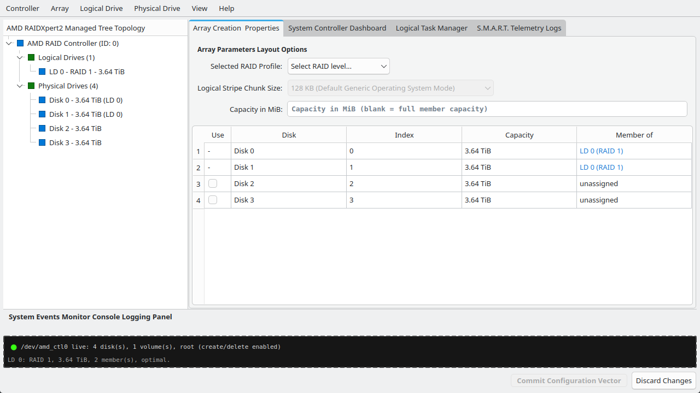
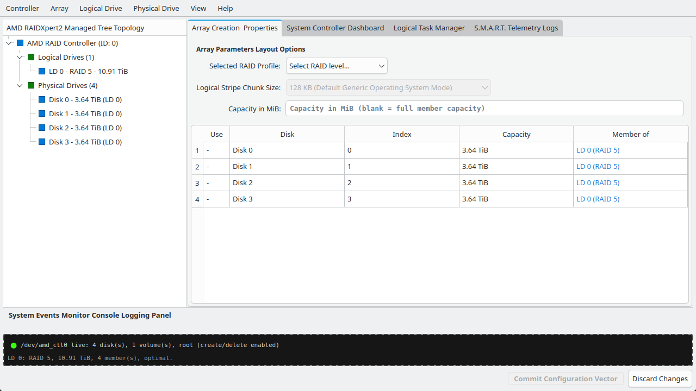

# OS install payload on each RAID level (2026-11-14)

What this measures: writing the complete Kubuntu 26.10 root filesystem onto
`/dev/rcraid0` at each level, then verifying it. It is the same filesystem
tree the installer lays down, written through the driver's normal write path;
it is **not** a run of the graphical installer itself (see "What this is not").

## Rig

| | |
|---|---|
| Array | 4 × Sabrent Rocket Q 4 TB behind `1022:B000`, `rcbottom`, `enable_writes=1 parity_writes=1 parity_create=1` |
| Host | AMD Ryzen 7 9700X, 30 GB RAM, kernel 7.3.0-10-generic, root on USB |
| Payload | `kubuntu-26.10-desktop-amd64.iso` → `casper/filesystem.squashfs`, 4,543,128,419 bytes (xz) |
| Written | 8,469,456,619 bytes, 245,745 filesystem entries |
| GUI | rcraidXpert, same build as the repo, screenshot per level below |

## Results

| Level | Members | Capacity | Raw seq write (8 GiB, O_DIRECT) | mkfs.ext4 | Payload write (8.47 GB) | Payload rate | e2fsck -fn | Raw seq read (4 GiB) | `/usr/bin/bash` hash |
|---|---|---|---|---|---|---|---|---|---|
| RAID 0 | 4 | 14,902 GiB | 8.3 GB/s | 6.00 s | 7.41 s | 1090 MiB/s | clean, 4.24 s | 9.4 GB/s | match |
| RAID 1 | 2 | 3,725 GiB | 2.9 GB/s | 1.96 s | 6.54 s | 1235 MiB/s | clean, 1.97 s | 4.8 GB/s | match |
| RAID 10 | 4 | 7,451 GiB | 5.0 GB/s | 3.34 s | 6.05 s | 1335 MiB/s | clean, 2.30 s | 4.7 GB/s | match |
| RAID 5 | 4 | 11,177 GiB | 777 MB/s | 4.14 s | 18.93 s | 427 MiB/s | clean, 3.37 s | 3.7 GB/s | match |

Every level: `mkfs.ext4` succeeded, the tree extracted with `unsquashfs -f`
without errors, `e2fsck -fn` reported the filesystem clean, and a file read
back from the array matched the squashfs content byte for byte.

## How to read the numbers

- **Raw write/read** are 8 GiB writes of zeros and 4 GiB reads with
  `O_DIRECT`, so they bypass the page cache and measure the array path.
- **Payload rate** is `unsquashfs` extracting a 4.5 GB **xz** squashfs with
  one thread. On RAID 0/1/10 the decompressor, not the array, is the limit —
  RAID 1 and RAID 10 "outrun" their own raw write figure for that reason.
  Only the RAID 5 payload number is array-bound, and it agrees with its raw
  write number.
- **RAID 5 sequential write is the outlier**: 777 MB/s against 3.7 GB/s read,
  i.e. ~4.8× slower writes than reads, while the same four disks stripe at
  8.3 GB/s in RAID 0. The parity write path serializes per volume lock rather
  than streaming full rows at member bandwidth. Tracked in #18; not a
  correctness failure — all data verified.
- **fsck is fast on every level** because most of each volume is still
  unwritten (lazily initialised inode tables); it is not a full-media scrub.
- RAID 5 parity is only initialised for the regions actually written. The
  volume as a whole still carries uninitialised parity outside them.

## Boot test (2026-11-14)

Each installed root was booted in QEMU with the array attached as the guest's
only disk, the host kernel and initrd (`7.3.0-10-generic`, the same Kubuntu
26.10 userspace) and `root=/dev/vda rw console=ttyS0`.

| Level | Array UUID | Boot result |
|---|---|---|
| RAID 0 | `6f8978f1-f3e0-45f8-a0ba-869294e30d3b` | `EXT4-fs (vda): mounted … r/w`, reached `Login Prompts`, `localhost login:` |
| RAID 1 | `24a2db92-5c04-44e8-96d7-913268f8de28` | same |
| RAID 10 | `c330c2e2-6300-46cd-9f6e-c703ecb95220` | same |
| RAID 5 | `455f7da2-0a9f-4a82-a73c-730951907fd1` | same |

**What this proves:** the exact tree written through the array (mkfs → 8.47 GB
unsquash → read-back → fsck) is a bootable Kubuntu 26.10 root: systemd mounts
it read-write, reaches `getty.target` and serves a login prompt.

**What it does not prove:** the guest reaches the array through virtio, not
through `rcraid`. Booting the *driver* at boot time (kernel + initramfs
carrying `rcraid.ko`, root on `/dev/rcraid0`) is still untested, because no
initramfs in this tree embeds the module and the firmware cannot boot an
array the driver presents. The first ISO `initrd` attempt failed for exactly
that reason — the ISO ships the casper live initramfs, which searches for a
live medium instead of honouring `root=`.

## Driver in the boot path (2026-11-13)

What this measures: whether an installed Kubuntu 26.10 root on each level
really boots with `rcraid` as the driver that mounts `/`. This is a separate
run from the payload measurements above; the array was rebuilt per level and
the install repeated end to end.

Method, per level:

1. Recreate the array with `rxp2adm` (RAID 5: discard the members, bootstrap
their device IDs with the rig's `mkmeta.py`, then DELETE and CREATE again
through the driver's writer), mkfs.ext4, and extract the ISO squashfs.
2. Copy the 7.3.0-10 kernel tree, install this tree's `rcraid.ko` plus
`packaging/sbin/rcraid-bind`, the udev rule, the modprobe drop-in
(`enable_writes=1 parity_writes=1`) and the initramfs hook, then build the
initramfs inside the target.
3. Boot that root in QEMU on the host kernel with the level's real member
disks attached as virtual NVMe and `snapshot=on`, so every guest write went to a
temporary overlay and the host media was only read. `root=UUID=… rw`;
the initramfs binds the virtual NVMe functions and mounts the array.
4. A first-boot systemd unit checks the root source, state and capacity, then
writes 1 GiB with `O_DIRECT`, drops caches and compares the read-back hash.

| Level | Members | Capacity | Raw write 8 GiB | Raw read 4 GiB | mkfs | Payload (8.47 GB) | Rate | e2fsck | Boot to PASS | Result |
|---|---|---|---|---|---|---|---|---|---|---|
| RAID 0 | 4 | 14,902 GiB | 7.27 GiB/s | 8.89 GiB/s | 6.08 s | 5.80 s | 1392 MiB/s | 4.51 s | 41 s | PASS |
| RAID 1 | 2 | 3,725 GiB | 2.48 GiB/s | 4.17 GiB/s | 2.00 s | 5.80 s | 1392 MiB/s | 2.02 s | 40 s | PASS |
| RAID 10 | 4 | 7,451 GiB | 4.42 GiB/s | 4.21 GiB/s | 3.41 s | 5.81 s | 1390 MiB/s | 2.22 s | 41 s | PASS |
| RAID 5 | 4 | 11,177 GiB | 1.56 GiB/s | 4.44 GiB/s | 4.36 s | 16.04 s | 528 MB/s | 3.45 s | 42 s | PASS |

Every level reported `root source: /dev/rcraid0`, `state: optimal`, the
capacity it was created with, and a matching 1 GiB write/read-back hash.

Limits of this run:

- QEMU's virtual NVMe is `1b36:0010`, so the boot initramfs copy used
  `allow_foreign_nvme=1` and bound the controllers by PCI class. The installed
  system's own udev rule keys on `1022:b000`; that rule is the expected path on
  real hardware but was **not** the mechanism exercised here. A real boot of an
  installed array still needs the machine rebooted with this initramfs.
- Writes were absorbed by the QEMU snapshot, so this proves the boot, mount and
  I/O path, not persistence across a reboot. The installed trees themselves
  lived on the array and were verified with `e2fsck -fn` after each install.
- RAID 5 CREATE is metadata-only; parity outside the written regions is still
  uninitialised, as in the payload runs.
- Not a run of the Calamares installer: it is the installer's filesystem
  payload plus the chroot/boot setup, as above.

## What this is not

- Not a run of the Kubuntu installer (Calamares/subiquity). No partition
  table, bootloader or `apt` stage was exercised; the filesystem was created
  directly on `/dev/rcraid0` and the root tree copied onto it. A real
  installer run needs a bootable guest whose initramfs carries `rcraid.ko`,
  because the stock Ubuntu initramfs does not.
- Not a firmware boot: firmware still cannot boot an array this driver
  presents. The QEMU run above boots the installed root with the driver in the
  initramfs; the host itself was never rebooted onto the array.
- Not a firmware-created array: every array here was stamped by this driver.

## Screenshots

Each was taken with the array freshly created and the GUI restarted, so the
tree and the state line reflect that level:

| Level | Screenshot |
|---|---|
| RAID 0 |  |
| RAID 1 |  |
| RAID 10 |  |
| RAID 5 |  |
